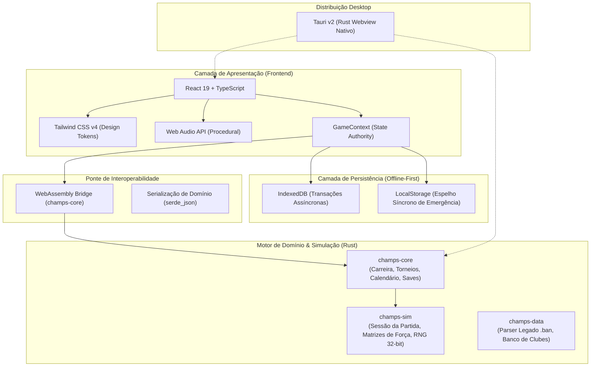
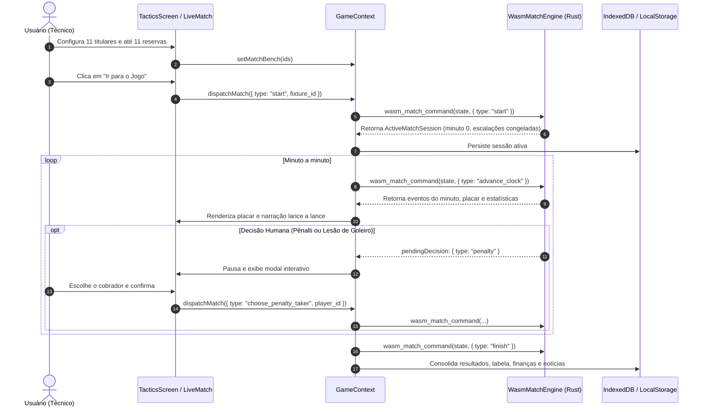

# Arquitetura do Sistema - Champs Manager 2026

Este documento descreve a arquitetura técnica, as decisões de design, o fluxo de dados e os princípios de engenharia que fundamentam o **Champs Manager 2026**.

---

## 1. Visão Geral da Arquitetura

O projeto foi projetado com base em um princípio fundamental: **longevidade, performance e integridade de domínio**. Em vez de acoplar regras de negócio em código de interface (JavaScript/React) ou depender de servidores e APIs remotas, o núcleo do jogo é uma biblioteca pura em **Rust**, compilada tanto para **WebAssembly (WASM)** quanto para binários nativos de desktop via **Tauri**.

---

## 2. Camadas do Sistema

### 2.1. Motor Central em Rust (`crates/`)

O código em Rust está organizado em um workspace modular, com separação estrita de responsabilidades:

1. **`champs-sim` (Simulação e Partida):**
   - **Sessão Determinística de 90 Minutos (`session.rs`):** Mantém o estado da partida em andamento (relógio por período, placar, eventos, substituições utilizadas e oportunidades consumidas).
   - **RNG de 32 bits:** Garante reprodutibilidade exata com base em sementes derivadas da carreira, temporada e partida, sem perda de precisão ao transitar entre WebAssembly e JavaScript.
   - **Cálculo de Forças por Setor:** Fórmulas matemáticas que combinam atributos de jogadores para gerar forças dinâmicas de Defesa, Meio-Campo e Ataque.
   - **Matrizes Anti-Goleada:** Proteção algorítmica para evitar discrepâncias irreais de placares, preservando a verossimilhança das partidas.

2. **`champs-core` (Carreira, Torneios e Contratos):**
   - **Modelos de Domínio:** Estruturas fortemente tipadas para `Club`, `Player`, `Tournament`, `MatchFixture` e `GameState`.
   - **Geração de Calendários:** Algoritmos para pontos corridos (ida e volta para 20 equipes nas Séries A, B, C e D) e chaveamentos mata-mata (com critérios de gols agregados e disputas de pênaltis).
   - **Persistência (.cmsav):** Formato binário compacto com compressão **Zstandard (`zstd`)**, permitindo saves instantâneos e ultracompactos.
   - **Ponte WASM (`wasm.rs` e `web_match.rs`):** Exporta as funções públicas consumidas pelo navegador via `wasm-bindgen`.

3. **`champs-data` (Importação e Dados Legados):**
   - **Parser Java Serialization:** Capacidade de ler e deserializar arquivos originais `.ban` do Brasfoot, viabilizando a conversão dos 703 clubes e mais de 14.600 atletas para o catálogo do jogo.

---

### 2.2. Camada WebAssembly (WASM Bridge)

A comunicação entre a interface web e o motor Rust ocorre via WebAssembly compilado pelo `wasm-pack`:

- **Autoridade Única:** A interface nunca calcula resultados ou desfechos de partidas por conta própria. Toda ação (iniciar jogo, avançar minuto, realizar substituição, confirmar batedor de pênalti) é disparada como um `MatchCommand` para a função `wasm_match_command`.
- **Preservação de Campos Extensíveis (`serde(flatten)`):** O contrato de dados entre Rust e TypeScript utiliza deserialização flexível, permitindo que campos adicionais do frontend (como configurações de UI, histórico recente e preferências visuais) transitem sem perda de dados.
- **Fallback Gracioso:** Caso o ambiente não suporte WebAssembly, a aplicação possui um motor de fallback em TypeScript que mantém as operações básicas ativas.

---

### 2.3. Camada de Apresentação (Frontend Web)

Construída sobre tecnologias web modernas e focada em densidade e responsividade:

- **React 19 & TypeScript:** Tipagem rigorosa sincronizada com as structs do Rust.
- **Tailwind CSS v4:** Estilização utilitária de alta performance, sem arquivos CSS inchados.
- **Club Atmospheric Theming (`clubTheme.ts`):** Sistema de variáveis CSS dinâmicas injetadas na raiz do documento (`#app-shell`). As cores de fundo (`--app-bg-deep`), superfícies (`--app-surface-1`, `--app-surface-2`) e destaques adaptam-se automaticamente à paleta oficial do clube gerenciado, preservando as cores funcionais (gramado verde, barras de energia e cartões).
- **Web Audio API Procedural (`soundEngine.ts`):** Sintetização de áudio em tempo real via osciladores e ruído branco para reproduzir apitos do juiz, chutes e a comemoração da torcida em gols, sem carregar arquivos MP3/WAV pesados.

---

### 2.4. Estratégia de Persistência (Offline-First)

Para assegurar que o jogador nunca perca o progresso de sua carreira:

1. **IndexedDB:** Banco de dados transacional do navegador onde o estado completo da carreira (`GameState`) e os slots de save manual são persistidos de forma assíncrona.
2. **LocalStorage (Espelho Síncrono de Emergência):** A cada evento ou minuto simulado da partida ao vivo, um espelho compacto da sessão ativa é gravado de forma síncrona. Se o jogador fechar a aba acidentalmente ou reiniciar o navegador durante uma partida, a sessão é restaurada pausada no minuto exato em que foi interrompida.
3. **Idempotência de Fechamento de Rodada:** O encerramento de cada rodada é protegido por marcadores transacionais (`committedAt`), impedindo que cliques duplos, atalhos de teclado ou recargas de página dupliquem receitas financeiras, pontos na tabela ou fadiga de atletas.

---

## 3. Fluxo de Execução da Partida

---

## 4. Diretrizes de Qualidade e Manutenibilidade

1. **Testes Unitários e de Integração:** Nenhuma regra de simulação ou mercado entra em produção sem testes automatizados correspondentes.
2. **Zero Dependência Externa em Runtime:** O jogo não faz requisições a servidores externos após o carregamento inicial dos assets estáticos.
3. **Imutabilidade e Determinismo:** Funções de cálculo de partida recebem uma semente numérica e produzem saídas estritamente idênticas para os mesmos parâmetros de entrada.
