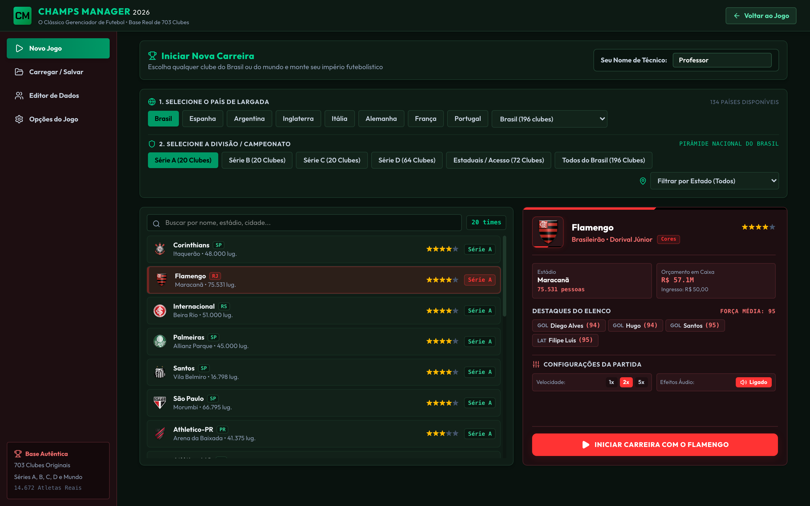
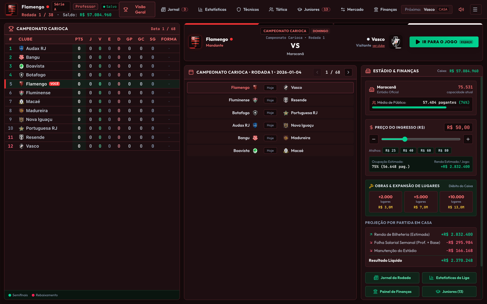
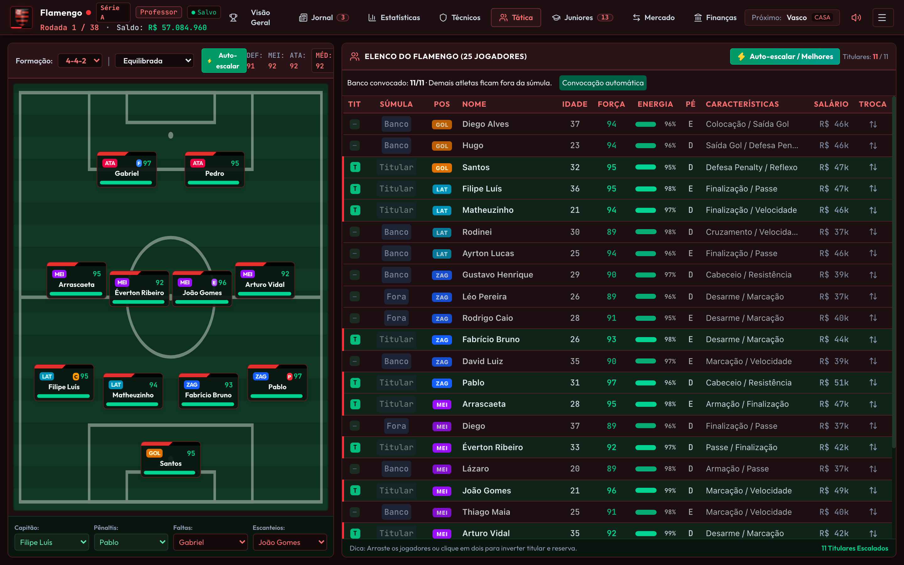
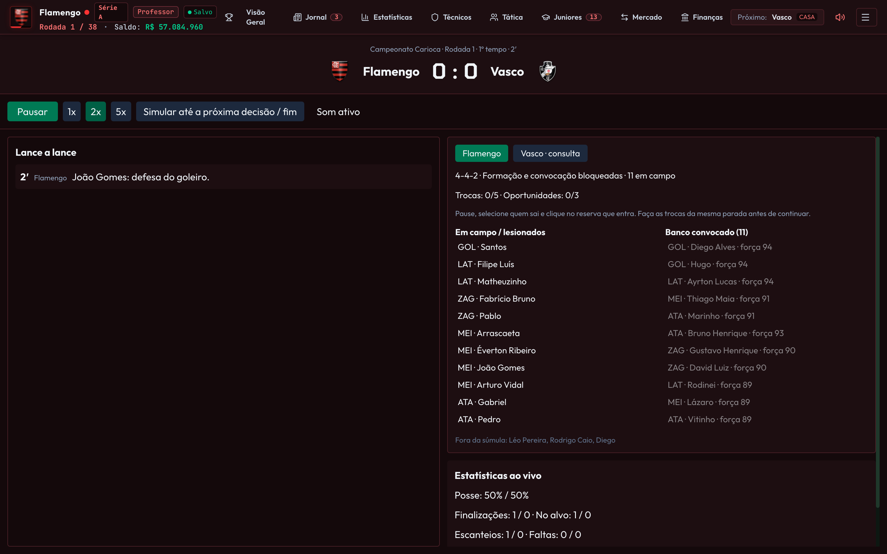
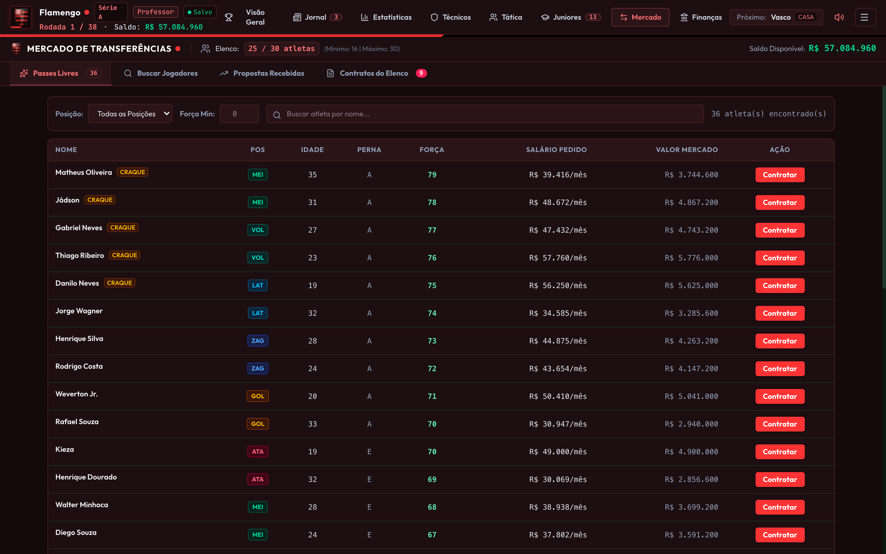
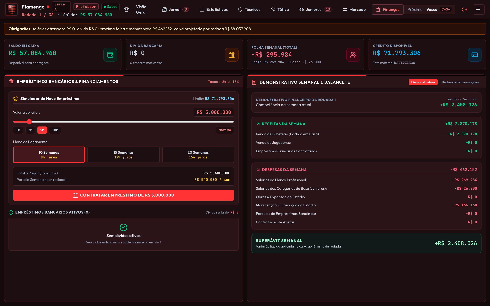

# Funcionalidades e Telas - Champs Manager 2026

Este documento detalha todas as telas, funcionalidades e interações de usuário disponíveis no **Champs Manager 2026**.

---

## 1. Menu Principal & Configuração de Carreira (`MainMenu.tsx`)

O Menu Principal é a porta de entrada para a experiência de gerenciamento de futebol.

### Recursos:
- **Base Real com 703 Clubes:** Permite iniciar uma carreira no Brasil ou no exterior.
  - **Pirâmide Brasileira Completa:** Séries A, B, C e D (com 20 clubes cada nas divisões A a C e 64 clubes na Série D), além de Campeonatos Estaduais e divisões de acesso.
  - **Ligas Internacionais:** Cobertura de mais de 130 países com suas ligas principais.
  - **Filtros por Estado e Divisão:** Seleção rápida de clubes filtrando por unidades federativas do Brasil (SP, RJ, MG, RS, etc.).
- **Card de Prévia do Clube:**
  - Escudo oficial renderizado com alta fidelidade.
  - Nome do treinador original da equipe.
  - Estádio oficial, cidade e capacidade total de público.
  - Orçamento inicial em caixa para contratações.
  - Destaques do elenco com posições e níveis de força dos principais atletas.
- **Personalização do Treinador:** Campo de texto para o jogador definir seu nome de manager.
- **Gerenciador de Saves:**
  - Salvamento manual em slots nomeados.
  - Carregamento de saves com data, rodada, clube e orçamento preservados.
  - Opções de exclusão de saves antigos.
- **Opções Gerais:** Controle de som (ligado/desligado), volume, velocidade padrão da partida (1x, 2x, 5x) e frequência do salvamento automático.
- **Editor de Dados Integrado (`TeamEditorScreen.tsx`):** Ferramenta para editar nomes de clubes, paletas de uniforme e atributos de jogadores.

---

## 2. Visão Geral do Clube (`ClubOverview.tsx`)

O painel central de controle do técnico durante o desenrolar da temporada.

### Recursos:
- **Tabela de Classificação Dinâmica:**
  - Classificação completa da divisão com Pontos (PTS), Jogos (J), Vitórias (V), Empates (E), Derrotas (D), Gols Pró (GP), Gols Contra (GC), Saldo de Gols (SG) e Histórico de Forma dos últimos jogos.
  - Faixas coloridas destacando zonas de classificação para torneios continentais (Libertadores, Pré-Libertadores, Sul-Americana) e zona de rebaixamento.
  - Identificador visual claro do clube comandado pelo jogador (`VOCÊ`).
- **Próximo Confronto (Match Hub):**
  - Card central exibindo mandante versus visitante, estádio da partida e status de mando de campo (CASA/FORA).
  - Botão chamativo **IR PARA O JOGO** (acionável diretamente pela tecla `Espaço`).
  - Opção para visualizar a escalação prevista do adversário através do atalho `ver clube`.
- **Calendário da Rodada:**
  - Lista de todos os confrontos da rodada atual e histórico de rodadas passadas ou futuras.
- **Módulo de Estádio & Finanças Rápidas:**
  - Nome do estádio, capacidade e média recente de público pagante.
  - Controle deslizante para precificar o ingresso das partidas em casa (com atalhos para R$ 25, R$ 40, R$ 60 e R$ 80).
  - Projeção em tempo real de ocupação do estádio e renda líquida estimada por jogo.
  - Módulos de expansão de arquibancadas (+2.000, +5.000, +10.000 lugares) com débito imediato no caixa do clube.

---

## 3. Prancheta Tática & Convocação de Súmula (`TacticsScreen.tsx`)

O coração tático do jogo, inspirado no clássico gramado verde do Brasfoot.

### Recursos:
- **Gramado Visual Interativo:**
  - 11 titulares posicionados geometricamente de acordo com o esquema tático selecionado (`4-4-2`, `4-3-3`, `3-5-2`, `4-5-1`, `5-3-2`).
  - Cartões dos jogadores exibindo apelido, número/posição, força individual (1 a 99), barra colorida de energia física e faixas temáticas nas cores do clube.
- **Arrastar e Soltar (Drag & Drop):**
  - Arraste um jogador para trocar de posição no campo ou inverter titulares e reservas do banco.
  - Suporte a clique duplo alternado para substituições rápidas.
- **Convocação de Súmula (Regra de 11 Reservas):**
  - Distinção estrita entre atletas **Titulares (T)**, **Banco Convocado (11 vagas)** e atletas **Fora da Súmula**.
  - Botão de **Convocação Automática** que seleciona os melhores suplentes respeitando a presença de um goleiro reserva elegível.
- **Configuração de Batedores Oficiais:**
  - Menus suspensos para definir o Capitão, Cobrador de Pênaltis, Cobrador de Faltas e Cobrador de Escanteios.
- **Forças Setoriais em Tempo Real:**
  - Indicadores numéricos recalculados dinamicamente para Defesa (DEF), Meio-Campo (MEI), Ataque (ATA) e Média Geral (MÉD).
- **Postura Tática:**
  - Alternância entre postura Defensiva, Equilibrada e Ofensiva.

---

## 4. Partida ao Vivo Minuto a Minuto (`LiveMatchScreen.tsx`)

Simulação determinística em tempo real impulsionada pelo motor compilado em WebAssembly.

### Recursos:
- **Placar Eletrônico & Relógio:**
  - Tempo decorrido de 0 a 90 minutos, com acréscimos distintos para o 1º e 2º tempos (45+2' e 90+2').
  - Notificação de gols com animação festiva e efeitos sonoros procedurais de torcida.
- **Narração Lance a Lance:**
  - Feed descritivo em português reportando finalizações, defesas de goleiro, faltas, cartões amarelos/vermelhos e lesões.
- **Controle de Fluxo e Velocidade:**
  - Botões para Pausar, Velocidade 1x, 2x, 5x e **Simular até a próxima decisão / fim**.
  - Parada obrigatória no intervalo de jogo para ajustes táticos.
- **Substituições Interativas (5 Trocas em 3 Oportunidades):**
  - Monitoramento independente de trocas restantes (0 a 5) e paradas restantes (0 a 3).
  - Substituições realizadas no intervalo não consomem janelas de parada.
  - Seleção intuitiva de quem sai e quem entra a partir do banco de reservas convocado.
- **Decisões Humanas em Pênaltis:**
  - A marcação de um pênalti a favor do usuário pausa o relógio e abre um modal para confirmação do cobrador antes da resolução do lance.
- **Tratamento de Lesões e Goleiro Improvisado:**
  - Lesão de goleiro aciona pausa para entrada do goleiro reserva; se não houver reservas disponíveis, um atleta de linha assume a meta com penalidade técnica proporcional.
- **Painel do Adversário (Modo Consulta):**
  - Aba para consultar a escalação, banco e postura tática do adversário em modo somente-leitura.
- **Estatísticas ao Vivo:**
  - Posse de bola percentual, chutes totais, finalizações no alvo, escanteios e faltas cometidas.

---

## 5. Mercado de Transferências & Contratos (`TransfersScreen.tsx`)

Ecossistema de negociações de jogadores com validação orçamentária e limites de elenco (mínimo de 16 e máximo de 30 atletas).

### Recursos:
- **Passes Livres (Free Agents):**
  - Lista de atletas sem contrato vigente disponíveis para contratação imediata sem pagamento de passe para outros clubes, negociando apenas termos salariais.
- **Pesquisa de Mercado:**
  - Filtros detalhados por setor (Goleiro, Lateral, Zagueiro, Volante, Meia, Atacante), faixa de força mínima (1-99) e idade.
- **Fazer Proposta:**
  - Envio de ofertas para clubes rivais com taxa de transferência, salário e duração do contrato.
- **Caixa de Entrada de Ofertas:**
  - Propostas recebidas de clubes da IA interessados em adquirir jogadores do seu elenco, com ações diretas de **Aceitar** ou **Recusar**.
- **Gestão de Contratos do Elenco:**
  - Relação dos anos restantes de contrato de cada jogador e funcionalidade de renovação antecipada.

---

## 6. Finanças, Obras do Estádio & Empréstimos (`FinancesScreen.tsx`)

Gestão econômica sustentável desenhada para equilibrar receitas e despesas semanais.

### Recursos:
- **Demonstrativo Semanal & Balancete:**
  - Receitas: Bilheteria dos jogos em casa, vendas de atletas e captação de recursos.
  - Despesas: Folha salarial do elenco profissional, salários das categorias de base, manutenção do estádio e amortização de empréstimos.
  - Indicador claro de Superávit ou Déficit semanal.
- **Simulador de Empréstimos Bancários:**
  - Limite de crédito proporcional à reputação e porte do clube.
  - Prazos de pagamento selecionáveis (10, 15 ou 20 semanas) com taxas de juros correspondentes (8% a 15%).
  - Cálculo automático de parcelas debitadas semanalmente direto do caixa.
- **Extrato Financeiro Transacional:**
  - Histórico cronológico de cada débito e crédito realizado pelo clube ao longo da temporada.

---

## 7. Categorias de Base / Juniores (`YouthScreen.tsx`)

- **Elenco de Promessas:** Plantel de 10 a 15 jovens atletas com idades entre 16 e 19 anos, gerados proporcionalmente ao prestígio do clube.
- **Promover ao Profissional:** Assina contrato profissional inicial e transfere o atleta para o elenco principal.
- **Dispensar da Base:** Libera vagas na categoria de base para a captação de novas promessas na virada de temporada.

---

## 8. Notícias, Estatísticas da Liga & Técnicos

- **Jornal da Rodada (`NewsFeed.tsx`):** Notícias automáticas destacando vitórias em clássicos, transferências de impacto, lesões graves de atletas e demissões de comandantes rivais.
- **Estatísticas da Divisão (`LeagueStatsScreen.tsx`):** Ranking dos maiores artilheiros, líderes de passes para gol e jogadores com mais advertências.
- **Mundo dos Treinadores (`ManagersScreen.tsx`):** Painel exibindo a reputação, tempo de cargo e aproveitamento de todos os técnicos da liga.

---

## 9. Visualizador de Clubes Adversários (`ClubViewer.tsx`)

Ao clicar em qualquer escudo ou nome de clube na tabela de classificação ou nos confrontos da rodada:
- Abertura de modal imersivo com o escudo, história, divisão, estádio e treinador daquela equipe.
- Aplicação das cores do adversário no cabeçalho via theming dinâmico.
- Visualização completa do elenco com forças e posições.
- Aba de **Tática Prevista** exibindo os 11 titulares que a IA colocará em campo contra você.
