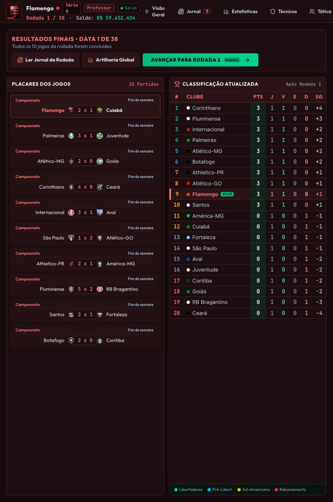

# Ciclo da partida do jogador — implementação e verificação

Implementado em 11/10/2026 com base em `PLANO_CICLO_PARTIDA_JOGADOR.md`.

## Domínio e persistência

`crates/champs-sim/src/session.rs` contém a sessão serializável, o relógio por período, o estado de RNG de 32 bits (sem perda de precisão ao passar por JSON/JavaScript), regras, escalações congeladas, banco nomeado, funções em campo, minutos individuais, placar, estatísticas, eventos com IDs estáveis e decisões pendentes. Cada minuto sorteia somente seus próprios lances e recalcula os setores com a escalação, energia e funções atuais. Os comandos rejeitados conservam o estado anterior.

`crates/champs-core/src/web_match.rs` adapta a sessão à carreira. O WASM exporta `wasm_match_command`, com início, convocação, pausa, retomada, velocidade, avanço, substituição, seleção/confirmação de cobrador, continuação sem reposição, simulação até decisão e consolidação. A semente deriva de carreira, temporada e fixture. A sessão principal inclui os jogos paralelos da mesma data, cada qual com RNG independente. Datas sem jogo humano usam o mesmo domínio. Equipes da IA sem onze atletas disponíveis recebem W.O. para não bloquear a data.

O React renderiza a sessão, sem gerar antecipadamente o confronto. A partida ao vivo exige WASM; falha de inicialização apresenta erro e conserva o save. As APIs antigas de simulação permanecem para compatibilidade e testes existentes, mas não são usadas no ciclo da carreira da interface.

O estado é espelhado imediatamente em LocalStorage e escrito em transações sequenciais no IndexedDB. A recarga prefere o espelho mais recente e retoma pausada. Saves manuais guardam a mesma sessão; slots automáticos continuam respeitando sua frequência própria. Visitar menus, consultar clubes, salvar ou ocultar a janela pausa a partida. Existe retorno global à sessão. Nova carreira e carregamento de outro slot exigem decisão explícita de abandono; avanço de data, mudanças de formação e mutações do elenco são bloqueados enquanto a partida estiver em curso.

Saves antigos sem sessão recebem banco automático elegível, com cobertura de goleiro, e abrem no planejamento se estavam na antiga tela ao vivo. Um banco explicitamente vazio permanece vazio. A migração também evita que tabelas vazias inseridas por DTOs antigos ocultem a tabela principal. A versão própria da sessão é 1; a versão da migração econômica permanece 2 para não repetir sua conversão de salários.

## Regras e apresentação

- Preparação: onze titulares, exatamente um goleiro natural e até onze reservas elegíveis e distintos. Tática identifica banco e fora da súmula e oferece convocação automática.
- Trocas: cinco atletas em três oportunidades; múltiplas trocas antes de avançar o relógio compartilham a parada. Intervalo não gasta oportunidade. Expulsos, atletas já usados e não convocados não retornam.
- Lesão: remove o atleta, registra gravidade e pausa para decisão humana. Goleiro convocado é oferecido quando houver troca válida. Sem ele, um atleta já em campo assume o gol por aptidão defensiva, força, energia e desempate por ID. Sua força de goleiro recebe multiplicador explícito de 0,28. Reserva de linha pode recompor a equipe; sem troca válida, permanecem dez atletas. Expulsão do goleiro exige retirar um jogador de linha para entrada do reserva.
- Pênalti: o evento antecede qualquer sorteio de resultado. Selecionar cobrador altera a decisão persistida, sem consumir RNG; confirmar resolve a cobrança. Só atletas elegíveis em campo aparecem. Disputas têm placar separado, ciclos de cobradores, redução a números iguais e encerramento antecipado ou morte súbita.
- Relógio: primeiro tempo termina em 45+2 e segundo em 90+2; período e tempo decorrido distinguem acréscimos do segundo tempo. O intervalo exige retomada explícita. Simulação rápida também para nas decisões humanas e no intervalo.
- Mata-mata: o perfil atual usa prorrogação e pênaltis para jogos únicos; na volta, empate agregado vai a pênaltis. `matchRules` no fixture pode configurar limites, prorrogação, disputa e agregado. Chaveamentos consomem o vencedor real da disputa, incluindo vitória visitante.
- Paralelos: começam ocultos; há filtros por competição e por data. Apenas minutos já simulados ficam na sessão, sem log futuro. Resultados fechados são reutilizados nas tabelas e na tela de resultados.
- Consolidação: valida encerramento e decisões, fecha paralelos, aplica resultados, tabelas, gols, assistências, cartões, fadiga e afastamentos uma vez. O React acrescenta o fechamento financeiro e as notícias antes de publicar a nova carreira. A autoridade síncrona evita duplicação por atalhos ou cliques repetidos. O marcador `committed` sobrevive ao save.
- Afastamentos: lesão moderada dura três partidas de ausência; expulsão ou acúmulo de três amarelos gera uma partida de suspensão. Os contadores só diminuem quando o clube disputa outra partida. Jogadores não utilizados recuperam energia.

## Evidências de verificação

| Critério do plano | Verificação |
| --- | --- |
| P0.1 / P0.2 | Teste com WASM real e carreira Flamengo: minuto 37, velocidade 5x, placar, log, RNG, banco e relógios paralelos idênticos após save, menu e migração; sequência restante idêntica à execução contínua. |
| P0.3 | Commit repetido, inclusive após desserialização, mantém estado, tabela e estatísticas idênticos. Fechamento financeiro também é idempotente. |
| P1.1 / P1.2 | Banco vazio, duplicado, 12º reserva, titular no banco, atleta inelegível e fora da súmula; bloqueio de escalação no Rust; adversário somente leitura conferido no navegador. |
| P1.3 | Duas trocas na mesma janela, três oportunidades, quarta parada rejeitada, intervalo gratuito, quinta troca, sexta rejeitada e reserva já utilizado. |
| P1.4 | Lesão de goleiro com reserva; sem goleiro; troca ou janela esgotada; força reduzida e decisão restaurada; expulsão e entrada do goleiro com retirada de linha; reposição da IA e afastamento pós-jogo. |
| P1.5 | Pênalti antes do sorteio, seleção persistida, cobrador inválido, conversão e estatísticas; decisões nos limites de intervalo/fim não são descartadas. |
| P2.1 | Projeção até minuto 37, ausência de eventos posteriores, exclusão de outra data e identidade do placar paralelo com a execução independente. |
| P2.2 | Prorrogação, disputa separada, parada para cobrador, vitória visitante no chaveamento de jogo único e agregado, data somente de IA e resultados reutilizados. |

Os 68 testes Rust de `champs-core` e `champs-sim` e os 54 testes web passaram. Os 19 testes Rust novos de sessão/adaptação e os cinco testes web novos cobrem o ciclo e os casos críticos. Comandos executados:

```sh
cargo test -p champs-core -p champs-sim --no-fail-fast
node web/node_modules/typescript/bin/tsc --project web/tsconfig.json --noEmit
cd web
node --experimental-strip-types --test tests/*.test.mjs
npm run wasm:build
npm run build
```

O build WASM foi executado pelo binário instalado em `web/node_modules/.bin/wasm-pack`, com alvo `web` e saída `web/src/wasm_pkg`. O build web concluiu; permanece o aviso de bundle acima de 500 kB. O compilador WASM também aponta a constante preexistente `ZSTD_LEVEL` não usada nessa plataforma.

No navegador: rejeição do 12º reserva; jogo até 6' com placar 0–1; Jornal e retorno sem mudança; recarga pausada no mesmo minuto; adversário com controles desabilitados; substituição de Pedro por Bruno Henrique; paralelos em 45+2; troca de intervalo com saldo de oportunidades intacto; encerramento em 90+2 e consolidação de 2–1; recarga dos resultados manteve tabela, oito notícias e saldo de R$ 59.652.454. O minuto 37 e os incidentes raros foram exercitados por testes determinísticos; não foram forçados na interface.



## Limites da verificação e do perfil

As probabilidades, a duração de lesão e o multiplicador do goleiro improvisado são parâmetros de produto desta implementação; não constituem reprodução comprovada do Brasfoot histórico. Formação, mentalidade e cobradores de falta/escanteio permanecem congelados durante o jogo; a escolha interativa de cobrador de pênalti é suportada. Não há regras específicas de substituição por concussão. O instalador desktop Tauri não foi empacotado nesta verificação; foram compilados o motor WASM e o frontend, além dos testes nativos de domínio.
