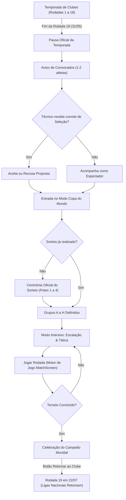

# SPEC-004: Refinamento de UX da Copa do Mundo, Sedes Oficiais, Sorteio Interativo de Grupos e Modo Imersivo

| Metadado | Detalhes |
| :--- | :--- |
| **Status** | Proposto / Em Especificação (Atualizado com Sedes e Sorteio) |
| **Data** | 13/10/2026 |
| **Autor** | Antigravity AI & Alex Chagas |
| **Módulo** | Seleções Nacionais, Copa do Mundo FIFA & Interface de Jogo |
| **Alinhamento** | Sedes FIFA (2026, 2030, 2034), Brasfoot Original e Mobile-First Design |

---

## 1. Contexto & Diagnóstico dos Problemas Atuais

Após a entrega inicial da Fase 4 e o feedback prático do usuário, identificamos os pilares essenciais para elevar a Copa do Mundo ao patamar definitivo de imersão e jogabilidade:

1. **Acesso Prematuro no Menu de Navegação:**
   - O botão "Copa do Mundo" estava visível permanentemente desde a Rodada 1 de janeiro, inclusive em anos sem Copa.
   - **Diretriz:** O torneio só deve ser acessado quando a temporada atingir a pausa de junho (após a Rodada 18).

2. **Falta de Identidade e Sedes Oficiais da Copa:**
   - Não havia menção de onde a Copa do Mundo estava acontecendo nem temas visuais personalizados.
   - **Diretriz:** Integrar o calendário oficial de sedes da FIFA:
     - **2026:** Estados Unidos 🇺🇸, México 🇲🇽 e Canadá 🇨🇦.
     - **2030:** Espanha 🇪🇸, Portugal 🇵🇹 e Marrocos 🇲🇦 (com jogos comemorativos do centenário na América do Sul).
     - **2034:** Arábia Saudita 🇸🇦.
   - Cada edição terá sua bandeira de sede, lema oficial, tema atmosférico e estádios anfitriões.

3. **Ausência do Sorteio Oficial dos Grupos (Previsibilidade Artificial):**
   - Os grupos vinham pré-definidos estaticamente desde o início do save, tirando a surpresa de "quem vai cair no meu grupo?".
   - **Diretriz:** Implementar a **Cerimônia do Sorteio Oficial da FIFA (Draw Ceremony)** com os 4 potes oficiais, revelação interativa das bolinhas ou sorteio instantâneo, com regras autênticas de confederação (máximo 2 europeus por grupo, máximo 1 de outras confederações).

4. **Falta de Imersão e Vazamento de Telas de Clube ("Modo Copa do Mundo"):**
   - Ao entrar na Copa, o usuário continuava vendo menus de clube (Mercado, Finanças, Juniores).
   - **Diretriz:** Ativar o **"Modo Copa do Mundo"**, onde o layout é 100% focado no torneio de seleções (escalação dos 23, tática da seleção, jogar as partidas pelo MatchEngine) até o encerramento do evento.

5. **Convocação Excessiva de Atletas de um Mesmo Clube (Ex: Cruzeiro):**
   - O código convocava 10 a 15 atletas do mesmo time para o Brasil.
   - **Diretriz:** Aplicar cota estrita de no máximo **1 a 2 jogadores por clube** (excepcionalmente 3 se houver múltiplos supercraques mundiais), selecionados estritamente por mérito de força decrescente.

6. **Responsividade em Telas Mobile:**
   - O chaveamento e as tabelas apresentavam cortes horizontais no smartphone.
   - **Diretriz:** Desenho mobile-first com abas de fases deslizantes e cards compactos de confronto.

---

## 2. Requisitos Funcionais (Spec Detalhado)

### RF-01: Sedes Oficiais da FIFA e Temas Atmosféricos
Definição estrutural dos ciclos de sede da Copa do Mundo:

```typescript
export interface WorldCupHostInfo {
  seasonYear: number;
  hosts: { countryId: number; name: string; flag: string; code: string }[];
  hostTitle: string; // Ex: "Estados Unidos, México & Canadá"
  hostSlogan: string; // Ex: "We Are 26 • Três Nações, Um Sonho"
  logoTheme: {
    primaryColor: string;
    secondaryColor: string;
    accentColor: string;
    badgeStyle: string;
  };
  famousStadiums: string[];
}

export const WORLD_CUP_HOSTS: Record<number, WorldCupHostInfo> = {
  2026: {
    seasonYear: 2026,
    hosts: [
      { countryId: 68, name: 'Estados Unidos', flag: '🇺🇸', code: 'EUA' },
      { countryId: 131, name: 'México', flag: '🇲🇽', code: 'MEX' },
      { countryId: 38, name: 'Canadá', flag: '🇨🇦', code: 'CAN' },
    ],
    hostTitle: 'Estados Unidos, México & Canadá',
    hostSlogan: 'América do Norte 2026 • Três Nações, Um Só Coração',
    logoTheme: {
      primaryColor: '#0f172a',
      secondaryColor: '#dc2626',
      accentColor: '#38bdf8',
      badgeStyle: 'bg-gradient-to-r from-red-600 via-white to-blue-600',
    },
    famousStadiums: ['MetLife Stadium (Nova York)', 'Estadio Azteca (Cidade do México)', 'BC Place (Vancouver)'],
  },
  2030: {
    seasonYear: 2030,
    hosts: [
      { countryId: 64, name: 'Espanha', flag: '🇪🇸', code: 'ESP' },
      { countryId: 154, name: 'Portugal', flag: '🇵🇹', code: 'POR' },
      { countryId: 129, name: 'Marrocos', flag: '🇲🇦', code: 'MAR' },
    ],
    hostTitle: 'Espanha, Portugal & Marrocos',
    hostSlogan: 'Centenário da Copa do Mundo 1930–2030 • Dois Continentes Unidos',
    logoTheme: {
      primaryColor: '#831843',
      secondaryColor: '#f59e0b',
      accentColor: '#10b981',
      badgeStyle: 'bg-gradient-to-r from-red-600 via-amber-500 to-emerald-600',
    },
    famousStadiums: ['Santiago Bernabéu (Madri)', 'Estádio da Luz (Lisboa)', 'Grand Stade de Casablanca'],
  },
  2034: {
    seasonYear: 2034,
    hosts: [
      { countryId: 9, name: 'Arábia Saudita', flag: '🇸🇦', code: 'ARS' },
    ],
    hostTitle: 'Arábia Saudita',
    hostSlogan: 'Growing. Together. • Ásia 2034',
    logoTheme: {
      primaryColor: '#064e3b',
      secondaryColor: '#10b981',
      accentColor: '#fbbf24',
      badgeStyle: 'bg-gradient-to-r from-emerald-800 to-amber-400',
    },
    famousStadiums: ['King Fahd Stadium (Riad)', 'King Abdullah Sports City (Jidá)'],
  },
};
```

---

### RF-02: Cerimônia do Sorteio Oficial dos Grupos (FIFA Draw Ceremony)
- **4 Potes Oficiais da FIFA:**
  - **Pote 1 (Cabeças de Chave & Sedes):**
    - Em 2026: EUA 🇺🇸, México 🇲🇽, Canadá 🇨🇦 + Brasil 🇧🇷, Argentina 🇦🇷, França 🇫🇷, Alemanha 🇩🇪, Inglaterra 🏴󠁧󠁢󠁥󠁮󠁧󠁿.
  - **Pote 2:** Espanha 🇪🇸, Itália 🇮🇹, Holanda 🇳🇱, Portugal 🇵🇹, Bélgica 🇧🇪, Uruguai 🇺🇾, Croácia 🇭🇷, Colômbia 🇨🇴.
  - **Pote 3:** Japão 🇯🇵, Senegal 🇸🇳, Suíça 🇨🇭, Dinamarca 🇩🇰, Coreia do Sul 🇰🇷, Marrocos 🇲🇦, Polônia 🇵🇱, Sérvia 🇷🇸.
  - **Pote 4:** Austrália 🇦🇺, Camarões 🇨🇲, Equador 🇪🇨, Nigéria 🇳🇬, Costa Rica 🇨🇷, Arábia Saudita 🇸🇦, Chile 🇨🇱, Egito 🇪🇬.
- **Experiência do Sorteio:**
  - Ao entrar na Copa do Mundo, se o sorteio da edição ainda não tiver ocorrido (`worldCup.drawCompleted === false`):
    - O jogo abre a **Tela Oficial do Sorteio da Copa do Mundo**:
      - Apresenta os 4 potes com as seleções e suas bandeiras.
      - Opção 1: **"Sortear Passo a Passo"** (revela os potes de 1 a 4 com efeito visual e animação de bolinha).
      - Opção 2: **"Realizar Sorteio Completo"** (distribui instantaneamente todas as 32 seleções nos Grupos A a H).
  - **Regra de Validação de Confederações:**
    - Máximo de 2 seleções da UEFA (Europa) por grupo.
    - Máximo de 1 seleção de qualquer outra confederação (CONMEBOL, CONCACAF, AFC, CAF) por grupo.
  - O resultado do sorteio define os 8 grupos e a tabela completa de confrontos da Fase de Grupos!

---

### RF-03: Gatilho Temporal e Visibilidade Condicional do Menu
- O menu de navegação de clube **NÃO** exibe a opção de Copa do Mundo durante o primeiro semestre ou em anos sem Copa.
- Ao concluir a Rodada 18 (31/05), o jogo dispara um **Aviso Oficial de Meio de Temporada**:
  - Exibe a lista dos 1 a 2 convocados do clube do usuário com a notícia de valorização no mercado.
  - Se o treinador for qualificado por reputação/títulos, abre o **Convite Oficial de Seleção Nacional** para assumir o comando de uma seleção no torneio.
  - Botão de ação: **"Acessar Copa do Mundo FIFA [Ano]"**.

---

### RF-04: Modo Imersivo da Copa do Mundo (`World Cup Mode`)
Quando o usuário está no Modo Copa do Mundo:
1. **Layout Focado:**
   - Menus de clube (Mercado de transferências, Finanças de clube, Juniores, etc.) são ocultados.
   - O cabeçalho exibe:
     - Identidade visual da sede (ex: *🇺🇸 🇲🇽 🇨🇦 Copa do Mundo 2026*).
     - Escudo da Seleção que o usuário comanda (se aceitou o cargo).
2. **Abas Exclusivas do Modo Copa:**
   - **1. Minha Seleção (Escalação & Tática):**
     - Disponível se o usuário comanda uma seleção.
     - Permite escalar os 11 titulares entre os 23 convocados, alterar formação tática (4-4-2, 4-3-3, etc.), definir capitão e batedores.
   - **2. Grupos & Tabela:** Classificação em tempo real dos grupos A a H.
   - **3. Chaveamento Mata-Mata:** Oitavas, Quartas, Semifinal e Final com atualização automática dos classificados.
   - **4. Jogar Partida:**
     - Botão em destaque para disputar a rodada da Copa.
     - Se a seleção do usuário joga, abre a partida interativa no motor de jogo (`MatchScreen`) com o uniforme da seleção e narração oficial!
3. **Encerramento e Retorno:**
   - Ao término do torneio, exibição da consagração do Campeão Mundial e botão **"Retornar ao Clube"**.
   - O jogo avança o calendário para a Rodada 19 (22/07) e restaura o menu normal do clube.

---

### RF-05: Cota Estrita de Convocados por Clube (Anti-Overcalling)
- **Teto Máximo:** No máximo **1 a 2 jogadores** (ou 3 em caso excepcional de múltiplos supercraques `isWorldTop`) de um mesmo clube nacional são convocados para a seleção.
- **Ordenação Decrescente de Mérito:** Apenas os maiores destaques técnicos do elenco (maior força ou `isStar`/`isWorldTop`) são convocados.
- **Resultado:** No Cruzeiro ou Flamengo, apenas os 1 ou 2 maiores craques vão para a Copa, espelhando a realidade do futebol.

---

### RF-06: Design Responsivo (Mobile-First)
- **Chaveamento no Smartphone:**
  - Seletor de fases em abas deslizantes: `Oitavas` | `Quartas` | `Semifinais` | `Final`.
  - Cards de confronto compactos com placares bem visíveis e toque mínimo de 44px.
- **Tabelas de Grupos:**
  - Visualização condensada em smartphones (`Pos`, `Seleção`, `PTS`, `J`, `SG`) com toque para expandir.
  - Carrossel de seleção de grupos (A a H) fácil de navegar no celular.

---

## 3. Fluxo de Estados



---

## 4. Plano de Implementação

| Etapa | Ação | Arquivos Impactados |
| :---: | :--- | :--- |
| **1** | **Modelo de Sedes & Potes da FIFA**<br>Definir sedes (2026, 2030, 2034), bandeiras, lemas e 4 potes oficiais. | `web/src/data/nationalTeamsData.ts`<br>`web/src/types/index.ts` |
| **2** | **Cerimônia do Sorteio Interativo**<br>Criar tela/módulo de sorteio com validação de potes e opção de sorteio rápido. | `web/src/components/WorldCupDrawModal.tsx`<br>`web/src/data/nationalTeamsData.ts` |
| **3** | **Cota Estrita de Convocação**<br>Limitar a 1-2 convocados por clube ordenados por mérito decrescente. | `web/src/data/nationalTeamsData.ts` |
| **4** | **Controle Temporal nos Menus**<br>Ocultar botão de Copa do Mundo no `Header` e `BottomNavBar` fora da janela da Copa. | `web/src/components/Header.tsx`<br>`web/src/components/BottomNavBar.tsx` |
| **5** | **Modo Copa do Mundo Imersivo**<br>Criar tela de imersão com escalação da seleção, chaveamento e botão de jogar rodada. | `web/src/components/WorldCupScreen.tsx`<br>`web/src/state/GameContext.tsx` |
| **6** | **Responsividade Mobile**<br>Chaveamento por fases e tabelas condensadas para smartphones. | `web/src/components/WorldCupScreen.tsx` |
| **7** | **Testes Automatizados**<br>Garantir 100% de aprovação nos testes de sorteio, sedes, cotas e navegação. | `web/tests/nationalTeamsAndWorldCup.test.mjs` |

---

## 5. Critérios de Aceite

1. **Sedes Visíveis:** A Copa do Mundo de 2026 destaca oficialmente os três países anfitriões (EUA 🇺🇸, México 🇲🇽, Canadá 🇨🇦), com lema e estádios.
2. **Sorteio Interativo:** O jogador participa ou aciona o sorteio dos grupos a partir dos 4 potes oficiais, acabando com a previsibilidade estática.
3. **Cota Realista por Clube:** No Cruzeiro (ou qualquer outro clube), no máximo 1 a 2 atletas são convocados.
4. **Menu Dinâmico:** A opção "Copa do Mundo" não polui os menus da carreira antes de junho ou em anos sem Copa.
5. **Modo Imersivo:** Ao jogar a Copa, os menus de clube somem e o usuário joga as partidas da seleção pelo motor oficial.
6. **Mobile Friendly:** Interface 100% responsiva sem rolagem horizontal indesejada no smartphone.
