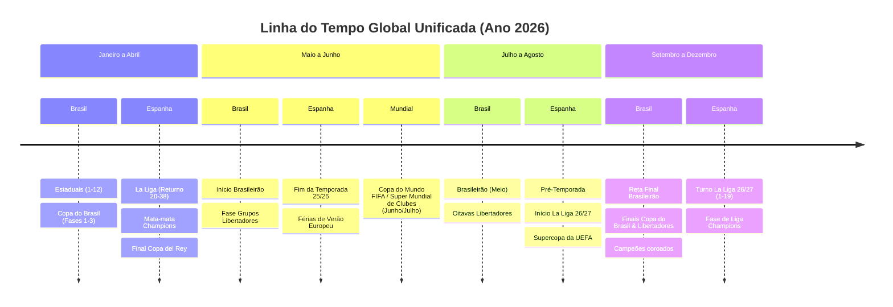

# SPEC-005: Calendário Real por Datas, Navegação Global de Tabelas, Segregação de Grupos e Arquitetura Multi-País (Brasil & Europa)

| Metadado | Detalhes |
| :--- | :--- |
| **Status** | Proposto / Em Especificação Técnica |
| **Data** | 13/10/2026 |
| **Autor** | Antigravity AI & Alex Chagas |
| **Módulo** | Calendário de Jogos, Sistema de Datas, Tabelas de Classificação & Motor Multi-País |
| **Alinhamento** | UX Imersiva, Brasfoot Moderno, Calendário FIFA/CONMEBOL/UEFA |

---

## 1. Diagnóstico dos Problemas e Necessidades do Usuário

O usuário identificou pontos críticos de fricção na experiência do usuário (UX) e modelagem de calendário:

1. **O indicador confuso "Data 19/68":**
   - Atualmente, o gerador de calendário divide o ano em 68 "slots de data" discretos (`fixtureDateIndex = 1..68`).
   - A interface renderiza `Data 19 / 68` no cabeçalho da tabela e no calendário. Isso é antinatural para um jogo de futebol. O usuário pensa em **data real** (ex: *14 de Maio de 2026*) e na **rodada da competição específica** (*Libertadores • Rodada 4 de 6*), e nunca num índice de slot de banco de dados.

2. **Formatação de datas e percepção temporal:**
   - As datas no banco de dados e nos fixtures estão em ISO (`2026-05-14`) ou sem tratamento adequado de localização em português (ex: *Qua, 14/05/2026* ou *14 de Maio de 2026*).
   - O jogador precisa de uma sensação viva de passagem de tempo: data de hoje, próximo compromisso e contagem regressiva para clássicos e jogos decisivos.

3. **Bloqueio de visualização de outras tabelas do país:**
   - A tabela de classificação à esquerda em `ClubOverview.tsx` e `RoundResultsScreen.tsx` fica travada na competição do dia atual. Se hoje tem jogo da Libertadores, o usuário só consegue ver a Libertadores; ele não consegue consultar como está a tabela do Brasileirão, a classificação do Estadual ou a chave da Copa do Brasil.

4. **Ausência de segregação de grupos na tela de jogos da rodada:**
   - Ao visualizar os jogos da rodada da Libertadores na coluna direita, o usuário não tem como navegar ou filtrar por Grupos (A, B, C, D) da mesma forma que já existe na tabela de classificação. Ele quer poder alternar entre "Todos", "Grupo A", "Grupo B", "Grupo C", etc.

5. **Dúvida arquitetural: Como sincronizar Brasil (Jan a Dez) e Europa/Espanha (Ago a Mai)?**
   - O calendário sul-americano segue o **ano civil** (Janeiro a Dezembro).
   - O calendário europeu segue a **temporada cruzada** (Agosto do ano X a Maio do ano X+1).
   - Como um simulador completo deve suportar ambos os modelos no mesmo save?

---

## 2. Soluções e Especificação Funcional

### 2.1. Eliminação Definitiva do "Data 19/68" e Formatação de Datas Reais

#### Regras de Apresentação:
- **Cabeçalho da Tabela de Classificação:**
  - Em vez de `Data 19 / 68`, exibir o progresso da competição visualizada:
    - *Pontos Corridos:* `Rodada 14 de 38` ou `14ª Rodada`
    - *Fase de Grupos:* `Fase de Grupos • Rodada 4 de 6`
    - *Mata-mata:* `Semifinal • Jogo de Ida` / `Final • Jogo Único`
- **Cabeçalho do Calendário / Jogos da Rodada:**
  - Exibir a data formatada em português brasileiro:
    - Formato expandido: `Quarta-feira, 14 de Maio de 2026`
    - Formato compacto: `Qua, 14/05/2026`
- **Card do Próximo Jogo (Next Match Hero Card):**
  - Exibir a data e dia da semana de forma destacada:
    - Ex: `🗓️ Quarta-feira, 14/05/2026 • 21:30` (com dia da semana já suportado: Qua/Qui/Dom).

#### Utilitário de Formatação (`web/src/utils/dateFormatter.ts`):
```typescript
export function formatMatchDate(dateStr?: string, format: 'short' | 'full' | 'weekday' = 'short'): string {
  if (!dateStr) return '';
  const [year, month, day] = dateStr.split('-').map(Number);
  const date = new Date(year, month - 1, day);
  
  if (format === 'short') {
    // Ex: "Qua, 14/05"
    const weekday = new Intl.DateTimeFormat('pt-BR', { weekday: 'short' }).format(date);
    const dayMonth = new Intl.DateTimeFormat('pt-BR', { day: '2-digit', month: '2-digit' }).format(date);
    return `${weekday.charAt(0).toUpperCase() + weekday.slice(1)}, ${dayMonth}`;
  }
  
  if (format === 'weekday') {
    // Ex: "Quarta-feira, 14/05/2026"
    const weekday = new Intl.DateTimeFormat('pt-BR', { weekday: 'long' }).format(date);
    return `${weekday.charAt(0).toUpperCase() + weekday.slice(1)}, ${day.toString().padStart(2, '0')}/${month.toString().padStart(2, '0')}/${year}`;
  }

  // Ex: "14 de Maio de 2026"
  return new Intl.DateTimeFormat('pt-BR', { day: 'numeric', month: 'long', year: 'numeric' }).format(date);
}
```

---

### 2.2. Seletor Livre de Competições nas Tabelas (Tab Bar / Dropdown)

O usuário poderá alternar entre qualquer tabela do ecossistema ativo a qualquer momento.

```
+----------------------------------------------------------------------------------+
| 🏆 TABELA DE CLASSIFICAÇÃO                                                      |
| [ Brasileirão Série A ] [ Copa Libertadores 🟢 ] [ Copa do Brasil ] [ Paulistão ]|
+----------------------------------------------------------------------------------+
```

#### Comportamento:
1. **Padrão inteligente:** Ao abrir a tela, a tabela selecionada é a competição do jogo de hoje (marcada com um indicador verde/dot `🟢 Em andamento hoje`).
2. **Navegação autônoma:** Ao clicar em outra aba (ex: "Brasileirão Série A"), a tabela é atualizada imediatamente sem avançar o jogo ou mudar a data do calendário.
3. **Persistência de visualização:** Caso o usuário queira ver a Série B, Série C ou chave da Copa, as tabelas estarão disponíveis no mesmo container.
4. **Copa do Brasil / Mata-mata:** Exibir a árvore de confrontos (Oitavas, Quartas, Semifinal, Final) com placares agregados e pênaltis.

---

### 2.3. Segregação de Grupos nos "Jogos da Rodada" (Calendário)

Quando a rodada atual do calendário envolver fases com múltiplos grupos (ex: Libertadores, Sul-Americana, Champions League, Copa do Mundo):

```
+----------------------------------------------------------------------------------+
| 📅 COPA LIBERTADORES • RODADA 4 DE 6 • QUA, 14/05/2026                          |
| Filtro de Grupo: [ Todos ] [ Grupo A (Seu) ] [ Grupo B ] [ Grupo C ] [ Grupo D ] |
+----------------------------------------------------------------------------------+
| GRUPO A:                                                                         |
|   Flamengo 2 x 1 River Plate                                                     |
|   LDU 0 x 0 Alianza Lima                                                         |
|                                                                                  |
| GRUPO B:                                                                         |
|   Palmeiras 3 x 0 Cerro Porteño                                                  |
|   Bolívar 1 x 1 Barcelona SC                                                     |
+----------------------------------------------------------------------------------+
```

#### Funcionalidades:
1. **Filtro Rápido de Abas:** O usuário pode clicar em `[ Grupo B ]` para ver apenas as partidas daquele grupo na rodada.
2. **Identificador de Grupo no Card do Jogo:** Cada card de partida exibe uma tag discreta (ex: `Grupo B`).
3. **Destaque do Jogo do Usuário:** O confronto do clube do usuário permanece no topo ou com destaque neon/verde.

---

### 2.4. Como Funciona a Convivência entre Calendários de Brasil e Europa (Espanha)

Esta é a resposta detalhada para a dúvida central: **"Como funciona quando eu tiver Espanha e Brasil, porque um começa no meio do ano e outro em janeiro?"**

#### O Problema Real:
- **Brasil:** Temporada = Ano Civil (01/Jan a 15/Dez de 2026).
  - Jan – Abr: Campeonatos Estaduais + Primeiras fases da Copa do Brasil.
  - Mai – Dez: Brasileirão (38 rodadas) + Fases finais da Libertadores e Copa do Brasil.
  - Dez – Jan: Férias e pré-temporada.
- **Espanha / Europa:** Temporada = Ano Cruzado (01/Ago de 2026 a 31/Mai de 2027).
  - Ago – Dez: Turno de La Liga (Rodadas 1 a 19) + Fase de Grupos da Champions + Copa del Rey.
  - Jan – Mai: Returno de La Liga (Rodadas 20 a 38) + Mata-mata da Champions + Final da Copa del Rey.
  - Jun – Jul: Férias de verão europeu e pré-temporada.

#### A Arquitetura Recomendada: "Calendário Mestre Global 365 Dias" com Ancoragem no País Principal

Em vez de criar universos separados ou forçar a Europa a começar em janeiro, o Champs Manager utiliza a **Ancoragem no País Principal do Save**:

1. **Se o usuário inicia o save no Brasil (Janeiro de 2026):**
   - O calendário do jogo se inicia em **Janeiro de 2026**.
   - Como a temporada europeia 2025/26 teve início em Agosto de 2025, os torneios selecionados na Europa (La Liga, Premier League, Champions) **já entram com o 1º Turno (Rodadas 1 a 19 e Fase de Grupos da Champions) pré-simulados e computados**!
   - As tabelas europeias já começam com jogos disputados, pontuação real, artilharia e momento de forma dos clubes.
   - Enquanto o jogador joga os Estaduais no Brasil (Jan a Abr), a Europa joga o Returno (rodadas 20 a 38).
   - Em Maio, a temporada europeia termina e são coroados os campeões de La Liga e Champions.
   - Em Junho/Julho, ocorre a pausa internacional (Copa do Mundo / Mundial de Clubes / Férias e Mercado de Verão Europeu).
   - Em Agosto, começa a nova temporada europeia 2026/27.

2. **Se o usuário inicia o save na Espanha / Europa (Agosto de 2026):**
   - O calendário do jogo se inicia em **Agosto de 2026** (início da temporada europeia 2026/27).
   - O Brasil já entra com os Campeonatos Estaduais concluídos e o 1º Turno do Brasileirão (Rodadas 1 a 19) pré-simulado!
   - O jogador acompanha a reta final do Brasileirão enquanto joga o início de La Liga.


        Espanha : Turno La Liga 26/27 (1-19) : Fase de Liga Champions
```

#### Vantagens Desta Abordagem:
1. **Mercado de Transferências Global Realista:**
   - **Janela de Janeiro:** No Brasil é pré-temporada (montagem de elenco); na Europa é a "Janela de Inverno" (ajustes de meio de época). Os clubes europeus vêm comprar destaques brasileiros no início do ano.
   - **Janela de Julho/Agosto:** Na Europa é a "Grande Janela de Verão" (grandes transações milionárias); no Brasil é a janela de meio de temporada.
2. **Torneios Globais Sem Conflito de Datas:**
   - O mês de **Junho** é universalmente a janela reservada para **Copa do Mundo de Seleções** e **Super Mundial de Clubes**. Ambos os continentes pausam suas ligas para a disputa planetária.
3. **Troca de Clube / Carreira Internacional:**
   - Se o treinador for campeão da Libertadores em novembro e receber proposta do Real Madrid ou Sevilla, ele assume em dezembro/janeiro exatamente no meio da temporada europeia (cenário clássico de treinador novo assumindo na virada do ano).

---

## 3. Plano de Implementação Passo a Passo

1. **Passo 1 (Interface - Imediato):**
   - Criar `dateFormatter.ts` para converter datas ISO em formato amigável pt-BR.
   - Remover `Data {gameState.currentRound} / {totalRounds}` em `ClubOverview.tsx` e `RoundResultsScreen.tsx`.
   - Substituir pela data real formatada e indicador da rodada da competição.
2. **Passo 2 (Navegação de Tabelas):**
   - Implementar a barra de navegação de competições em `ClubOverview.tsx` permitindo alternar entre Estadual, Nacional, Continental e Copa.
3. **Passo 3 (Segregação de Grupos nos Jogos da Rodada):**
   - Adicionar barra de abas de Grupos (Todos, A, B, C, D) nos jogos da rodada continental.
4. **Passo 4 (Motor Global de Calendário Multi-País):**
   - Formalizar no motor Rust/WASM o scheduler de calendário com offsets para países do hemisfério norte (agosto a maio) e hemisfério sul (janeiro a dezembro).

---

## 4. Critérios de Aceite (Testes & Validação)

- [ ] **Sem "Data 19/68":** Nenhuma tela apresenta "Data X / Y" onde Y é o total de datas do ano.
- [ ] **Datas Formatadas:** As datas aparecem como `Qua, 14/05/2026` ou `14 de Maio de 2026`.
- [ ] **Navegação de Tabelas:** O usuário consegue visualizar a tabela do Brasileirão mesmo quando a rodada de hoje for da Libertadores.
- [ ] **Filtro de Grupos:** O usuário pode filtrar e inspecionar os jogos do Grupo B, C e D na Libertadores.
- [ ] **Compatibilidade:** Testes automatizados continuam passando sem regressões de build.
