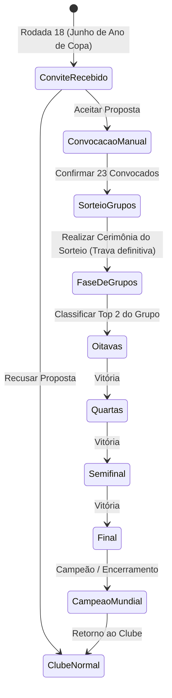

# SPEC-006: Redesign da Copa do Mundo, Convocação Manual de Seleções e Integridade de Nacionalidades

- **Autor:** Champs Manager Architecture Team
- **Data:** 13 de Outubro de 2026
- **Status:** Proposto / Em Análise
- **Impacto:** Alto (Modelos de Jogador, Base de Dados de Seleções, UI/UX da Copa do Mundo, Fluxo do Torneio)

---

## 1. Visão Geral & Problemas Identificados

Com base nos testes de gameplay e nos apontamentos do usuário, foram detectadas falhas estruturais e de experiência que necessitam de uma reengenharia completa:

1. **Bug Crítico de Nacionalidade (O "Caso Lucas Villalba"):**
   - No modelo atual (`Player`), não existe o atributo de nacionalidade (`countryId` ou `nationality`).
   - O algoritmo de convocação inferia a nacionalidade do jogador a partir do clube em que ele joga (`userClub.countryId || 29`).
   - Consequência: Atletas estrangeiros que atuam no Brasil (como Lucas Villalba, argentino do Cruzeiro, De Arrascaeta, Cano, Calleri, etc.) eram erroneamente considerados brasileiros e convocados para a Seleção Brasileira.
2. **Ausência da Convocação Manual Ativa pelo Usuário (Estilo Brasfoot):**
   - No Brasfoot clássico, ao assumir o comando de uma seleção nacional, o treinador tem o poder e o dever de **convocar seus jogadores**.
   - O jogador pesquisa atletas de sua nacionalidade em uma tela com barra de busca, filtros de posição (GOL, LAT, ZAG, VOL, MEI, ATA), força e clube, montando sua lista oficial de 23 atletas.
3. **Desafio de Seleções Não-Principais (Austrália, Japão, Senegal, etc.):**
   - O jogo carrega ligas de certos países, mas não carrega ligas de dezenas de nações participantes da Copa do Mundo (ex: Austrália, Arábia Saudita, Japão, Tunísia).
   - Se o usuário assumir ou enfrentar a Austrália, o sistema precisa fornecer um pool realista e autêntico de atletas australianos para convocação e disputa.
4. **Fluxo Cronológico e Trava do Sorteio:**
   - O sorteio não pode ser repetido à vontade pelo usuário ("ressorteio"). Uma vez sorteado, os grupos tornam-se definitivos e imutáveis.
   - O fluxo deve ser claro e linear:
     $$\text{Convite} \longrightarrow \text{Aceite} \longrightarrow \text{Convocação Oficial (23 atletas)} \longrightarrow \text{Sorteio dos Grupos (One-Way)} \longrightarrow \text{Disputa}$$
5. **Remoção de Telas Desnecessárias:**
   - A tela "Convocados do seu clube" foi considerada dispensável e poluente pelo usuário. O foco deve ser 100% na Seleção comandada e na disputa da Copa do Mundo.
6. **Redesign Visual:**
   - O design precisa ser elevado a um padrão premium de futebol (estilo caderno de torneio FIFA / transmissão televisiva internacional), com navegação fluida, visualização de campo tático e total responsividade mobile.

---

## 2. Diagnóstico Técnico & Arquitetura de Dados

### 2.1 Causa Raiz do Bug de Nacionalidade
No arquivo `web/src/types/index.ts`, a interface `Player` define:
```typescript
export interface Player {
  id: number;
  name: string;
  age: number;
  position: Position;
  foot: 'D' | 'E' | 'A';
  strength: number;
  energy: number;
  salary: number;
  marketValue: number;
  isStarter: boolean;
  isStar: boolean;
  isWorldTop: boolean;
  // ... FALTAM countryId e nationality!
}
```
E em `web/src/data/nationalTeamsData.ts`:
```typescript
const playerCountryId = userClub.countryId || 29; // ERRO CRÍTICO!
```
Qualquer jogador que jogasse no Cruzeiro herdava `countryId = 29` (Brasil).

### 2.2 Solução Estrutural de Nacionalidades
1. **Extensão da Interface `Player`:**
   ```typescript
   export interface Player {
     id: number;
     name: string;
     countryId?: number;     // ID autêntico do país de nascimento/nacionalidade
     nationality?: string;   // Sigla ou nome do país (ex: "ARG", "BRA", "URU")
     // ...
   }
   ```
2. **Dicionário de Estrangeiros Notáveis (Clube-Origem e Jogadores Históricos):**
   - Criação de um catálogo de nacionalidades para jogadores estrangeiros conhecidos atuando nas ligas disponíveis.
   - Jogadores gerados em ligas específicas recebem o `countryId` daquela liga por padrão, mas atletas transferidos mantêm seu `countryId` imutável por toda a carreira.
   - Regra estrita de convocação:
     $$\text{Elegível}(\text{jogador}, \text{seleção}) \iff \text{jogador.countryId} == \text{seleção.countryId}$$

---

## 3. Banco de Dados de Seleções Globais & Países Não-Principais

### 3.1 O Pool de Jogadores Internacionais (`internationalPlayersPool`)
Para seleções como Austrália, Japão, Canadá, Senegal, Gana, Coreia do Sul, Estados Unidos, etc., que podem não ter 100% de seus clubes locais carregados na liga ativa:
- Criar uma base de dados estruturada com 25 a 30 atletas autênticos por país classificado para a Copa do Mundo.
- Cada atleta possui nome autêntico, posição correta, força equilibrada (conforme reputação da seleção), idade e clube de procedência (ex: Mathew Ryan, goleiro, Austrália, Roma/AZ).
- Quando o treinador comanda essa nação ou abre a tela de convocação, esses atletas estão imediatamente disponíveis para busca, escalação e convocação.

---

## 4. Central de Convocação Manual (Fidelidade ao Brasfoot)

### 4.1 Interface de Convocação (`NationalCallupScreen`)
Ao aceitar o convite para comandar uma seleção:
1. **Regra dos 23 Atletas:**
   - 3 Goleiros obrigatórios.
   - 7 a 8 Defensores (Laterais e Zagueiros).
   - 7 a 8 Meio-Campistas (Volantes e Meias).
   - 4 a 5 Atacantes.
   - Total exato: **23 jogadores**.
2. **Filtros e Mecanismo de Busca:**
   - Campo de pesquisa em tempo real por nome do jogador (`SearchInput`).
   - Filtro de setor/posição: `Todos | GOL | LAT | ZAG | VOL | MEI | ATA`.
   - Filtro por faixa de força: `Todos | 80+ | 70-79 | 60-69 | <60`.
   - Ordenação: Maior Força, Mais Jovem, Mais Velho, Nome A-Z.
3. **Ações do Treinador:**
   - `Convocados (X/23)`: Painel lateral ou superior com a lista atual.
   - Botão `[+ Convocar]` para incluir um jogador elegível da lista global.
   - Botão `[✕ Desconvocar]` para liberar vaga.
   - Botão `[Auto-Convocar]`: Seleciona automaticamente os melhores jogadores por posição para conveniência rápida.
   - Botão `[Confirmar Convocação Oficial]`: Só fica habilitado quando a lista tiver exatamente 23 jogadores elegíveis (incluindo no mínimo 3 goleiros).

---

## 5. Fluxo Cronológico e Bloqueio do Sorteio (Tournament Draw Flow)

### 5.1 O Ciclo Linear do Torneio


### 5.2 Trava Antirre-sorteio
- Ao clicar em "Sortear Grupos", a chave `worldCupTournament.drawCompleted` é setada para `true`.
- O botão de sorteio é substituído permanentemente pela tabela oficial dos Grupos A a H.
- A semente do sorteio é persistida no `GameState` e no save slot.

---

## 6. Redesign Visual & Experiência de Usuário (UI/UX)

1. **Aba "Convocados do seu clube" Eliminada:**
   - A aba foi descartada conforme orientação direta do usuário.
2. **Estrutura das Abas da Copa do Mundo:**
   - **Aba 1: Minha Seleção (Tática e Escalação)**:
     - Prancheta de campo interativa com formação (4-4-2, 4-3-3, 3-5-2, 4-5-1, 5-3-2) e mentalidade.
     - 11 titulares posicionados graficamente e 12 reservas no banco.
     - Indicador de capitão, batedor de faltas e pênaltis.
   - **Aba 2: Convocação (Disponível até o início dos jogos)**:
     - Central de busca e troca de atletas antes do início da fase de grupos.
   - **Aba 3: Fase de Grupos**:
     - Visualização dos 8 grupos A-H com tabela de classificação, saldo de gols e jogos da rodada.
   - **Aba 4: Mata-Mata**:
     - Visualização fluida das Oitavas, Quartas, Semifinal e Final, com pílulas de navegação rápida em mobile para evitar scroll excessivo e quebras de layout.
3. **Identidade Visual por Edição:**
   - 2026: Visual das 3 nações anfitriãs (EUA, México, Canadá) com detalhes em vermelho, azul-marinho e dourado.

---

## 7. Estado Atual e Desativação Temporária

Conforme determinação do usuário:
- A flag `WORLD_CUP_FEATURE_ENABLED = false` foi aplicada em:
  - `web/src/data/nationalTeamsData.ts`
  - `web/src/components/Header.tsx`
  - `web/src/components/BottomNavBar.tsx`
  - `web/src/App.tsx`
- A opção de Copa do Mundo está **completamente oculta de todos os menus e fluxos normais**, permitindo que o usuário jogue a carreira de clubes sem qualquer interferência visual ou operacional.
- O código e os 13 testes unitários foram preservados intactos para a ativação coordenada na próxima etapa.

---

## 8. Cronograma de Execução Proposto

| Etapa | Atividade | Entregáveis |
| :--- | :--- | :--- |
| **Etapa 1** | Refatoração de Nacionalidades | Adicionar `countryId` a `Player`, catálogo de nacionalidades e testes unitários de elegibilidade |
| **Etapa 2** | Base de Dados Internacional | Base com 25-30 atletas por seleção participante (Austrália, Japão, etc.) |
| **Etapa 3** | Central de Convocação Manual | Tela com busca, filtros de posição, contagem 23/23 e validação de 3 goleiros |
| **Etapa 4** | Fluxo Linear do Sorteio | Trava irrevogável pós-sorteio e integração sequencial pós-convocação |
| **Etapa 5** | Novo Design Visual & Reativação | Design polido, teste completo com 93+ testes passando e remoção da flag de ocultação |
