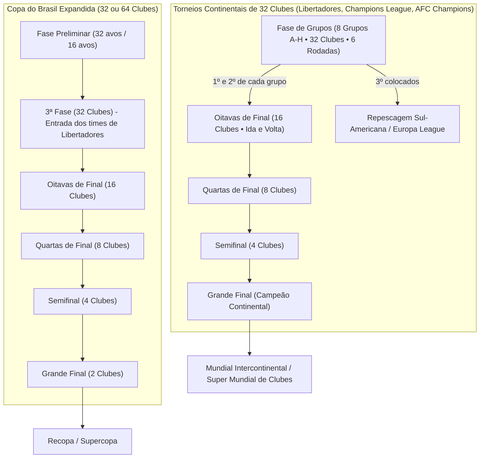

# SPEC-008: Expansão de Torneios — Copa do Brasil, Libertadores (32 Clubes), Champions League, Champions Asiática e Copas Continentais

| Metadado | Detalhes |
| :--- | :--- |
| **Status** | Proposto / Em Especificação Técnica |
| **Data** | 13/10/2026 |
| **Autor** | Antigravity AI & Alex Chagas |
| **Módulo** | Gerador de Calendário, Chaveamento de Mata-mata, Copas Continentais & Motor de Qualificação |
| **Alinhamento** | Fidelidade Histórica (Brasfoot), Realismo CONMEBOL/UEFA/AFC/CBF, Balanceamento de Calendário |

---

## 1. Diagnóstico do Estado Atual e Gaps Identificados

Após a revisão do código-fonte de geração de calendário (`calendarGenerator.ts`), seleção de representantes internacionais (`continentalRepresentatives.ts`) e chaveamento (`qualification.ts`), foram mapeadas as seguintes limitações estruturais:

### 1.1. Copa do Brasil / Copa Nacional (Atualmente limitada a 16 clubes)
* **Estrutura atual:** Seleciona apenas os 16 maiores clubes do país e inicia direto nas **Oitavas de Final** (8 confrontos em ida e volta: Oitavas, Quartas, Semifinal e Final = 8 rodadas).
* **Problema:** Não existem as fases preliminares (1ª, 2ª e 3ª fases) características da Copa do Brasil real. Clubes das Séries B, C, D e campeões estaduais menores ficam de fora, reduzindo a sensação de "zebra" e a emoção do mata-mata democrático com viagens a times menores.

### 1.2. Copa Libertadores e UEFA Champions League (Atualmente limitadas a 16 clubes)
* **Estrutura atual:**
  * 16 clubes divididos em 4 grupos de 4 times (Grupos A, B, C e D).
  * 6 rodadas na fase de grupos.
  * Apenas o 1º e 2º colocados de cada grupo se classificam (8 clubes), pulando **direto para as Quartas de Final**.
* **Problema:**
  * A **Copa Libertadores real** e a **Champions League clássica** são consagradas com **32 clubes** (8 grupos de 4 times: Grupos A a H).
  * Com apenas 16 clubes, grandes potências da América do Sul (ex: Racing, Grêmio, Internacional, Olimpia, Peñarol, LDU, Atlético Nacional) e da Europa (ex: Arsenal, Juventus, PSG, Liverpool, Dortmund, Atlético de Madrid) acabam ficando de fora da mesma edição por falta de vagas no chaveamento.
  * Falta a emocionante fase de **Oitavas de Final** continental (16 classificados).

### 1.3. Ausência de Competições Continentais para Ásia, África e Outros Continentes
* **Estrutura atual em `continentalRepresentatives.ts`:**
  * América do Sul $\rightarrow$ Libertadores / Sul-Americana.
  * Europa $\rightarrow$ Champions League / Europa League.
  * América do Norte/Central $\rightarrow$ CONCACAF Champions Cup.
  * **Ásia (Japão, Arábia Saudita, Coreia do Sul, etc.), África (Egito, Marrocos, África do Sul, etc.) e Oceania:** Caem num fallback genérico que pula direto para o `Mundial de Clubes FIFA`.
* **Problema:** Ao gerenciar clubes gigantes da Ásia (ex: Al-Hilal, Al-Nassr, Urawa Red Diamonds, Vissel Kobe, Al-Ittihad) ou da África (Al Ahly, Wydad), não existe a **AFC Champions League (Champions Asiática)** nem a **CAF Champions League**.

---

## 2. Visão Geral da Arquitetura Proposta

---

## 3. Especificação Detalhada por Competição

### 3.1. Copa Libertadores da América (Expansão para 32 Clubes)

#### Composição do Pote de 32 Clubes:
* **Brasil (7 a 8 vagas):** Campeão da Libertadores anterior, Campeão da Copa do Brasil, Top 5 ou 6 do Brasileirão Série A.
* **Argentina (5 a 6 vagas):** Campeão Argentino, Campeão da Copa Argentina, River Plate, Boca Juniors, Racing, etc.
* **Uruguai (2 a 3 vagas):** Nacional, Peñarol, etc.
* **Colômbia (2 a 3 vagas):** Millonarios, Atlético Nacional, Junior Barranquilla.
* **Chile (2 a 3 vagas):** Colo-Colo, Universidad de Chile, Universidad Católica.
* **Equador (2 vagas):** LDU Quito, Independiente del Valle, Barcelona SC.
* **Paraguai (2 vagas):** Olimpia, Cerro Porteño, Libertad.
* **Peru, Bolívia e Venezuela (1 a 2 vagas cada):** Alianza Lima, Bolívar, The Strongest, Deportivo Táchira, etc.

#### Formato de Disputa:
1. **Fase de Grupos (8 Grupos de 4 Clubes: A a H):**
   * 6 rodadas em turno e returno (Ida e Volta).
   * **Datas no calendário:** Ocorrem nas quartas-feiras do 2º semestre (mesmas 6 semanas atuais).
   * **Classificação:** 
     * 1º e 2º colocados $\rightarrow$ Avançam para as **Oitavas de Final**.
     * 3º colocado $\rightarrow$ Vaga na fase de mata-mata da **Copa Sul-Americana** (opcional, como na CONMEBOL real).
2. **Fase Eliminatória (Mata-Mata):**
   * **Oitavas de Final:** 16 clubes em 8 confrontos de Ida e Volta (+2 datas de quarta-feira).
   * **Quartas de Final:** 8 clubes em 4 confrontos de Ida e Volta (2 datas).
   * **Semifinal:** 4 clubes em 2 confrontos de Ida e Volta (2 datas).
   * **Final:** Jogo Único em campo neutro (ou Ida e Volta com mando do melhor agregado).

---

### 3.2. UEFA Champions League (Expansão para 32 Clubes)

#### Composição do Pote de 32 Clubes:
* **Inglaterra (4 a 5 vagas):** Man City, Arsenal, Liverpool, Aston Villa, Chelsea, Man United.
* **Espanha (4 a 5 vagas):** Real Madrid, Barcelona, Atlético de Madrid, Girona, Athletic Bilbao.
* **Itália (4 a 5 vagas):** Inter de Milão, Milan, Juventus, Atalanta, Roma, Napoli.
* **Alemanha (4 a 5 vagas):** Bayern München, Bayer Leverkusen, Borussia Dortmund, RB Leipzig.
* **França (3 a 4 vagas):** PSG, Monaco, Lille, Marseille.
* **Portugal (2 a 3 vagas):** Benfica, Sporting, Porto.
* **Holanda (2 vagas):** PSV Eindhoven, Feyenoord, Ajax.
* **Outros Países Europeus (Bélgica, Turquia, Escócia, Suíça, Áustria, etc.):** Club Brugge, Galatasaray, Celtic, etc.

#### Formato de Disputa:
* Idêntico à Libertadores: 8 grupos (A a H) $\rightarrow$ Oitavas de Final (16 clubes) $\rightarrow$ Quartas $\rightarrow$ Semifinais $\rightarrow$ Final em Jogo Único.

---

### 3.3. Novas Competições Continentais Dedicadas

#### A. AFC Champions League (Champions Asiática)
* **Elegibilidade:** Clubes de países membros da Confederação Asiática de Futebol (AFC).
  * Arábia Saudita (164), Japão (109), Coreia do Sul (112), Catar (156), Emirados Árabes Unidos (194), Austrália (14), Irã (99), China (44).
* **Formato:** 16 ou 32 clubes.
* **Clubes de Destaque:** Al-Hilal, Al-Nassr, Al-Ittihad, Al-Ahli, Urawa Red Diamonds, Vissel Kobe, Kawasaki Frontale, Yokohama F. Marinos, Jeonbuk Hyundai, Ulsan HD, Al-Sadd.
* **Vaga:** O campeão garante vaga no Super Mundial de Clubes e na Copa Intercontinental.

#### B. CAF Champions League (Champions Africana)
* **Elegibilidade:** Clubes de países africanos (Egito, Marrocos, África do Sul, Tunísia, Argélia, etc.).
* **Clubes de Destaque:** Al Ahly, Zamalek, Wydad Casablanca, Raja Casablanca, Mamelodi Sundowns, Espérance de Tunis.

#### C. CONCACAF Champions Cup (América do Norte e Central)
* **Elegibilidade:** México (131), Estados Unidos (68), Canadá (38), Costa Rica (51), etc.
* **Clubes de Destaque:** América-MEX, Monterrey, Tigres, Pachuca, Columbus Crew, Inter Miami, LAFC, Seattle Sounders, Saprissa.

---

### 3.4. Copa do Brasil (Expansão de 16 para 32 ou 64 Clubes)

Temos duas abordagens viáveis para o design da Copa do Brasil:

#### Opção A: Formato Autêntico CBF (Misto: Fase Preliminar + 3ª Fase)
1. **1ª e 2ª Fases (Fevereiro a Março - Jogo Único):**
   * Disputada exclusivamente por clubes menores dos Estaduais e Séries B, C e D.
   * Os clubes que estão na Libertadores **NÃO** jogam as duas primeiras fases.
   * Jogos disputados nas quintas-feiras do 1º semestre (durante os Estaduais).
2. **3ª Fase (32 Clubes - Maio):**
   * Entram os times da Libertadores e os cabeças-de-chave da Série A.
   * 16 confrontos em jogos de Ida e Volta.
3. **Oitavas de Final $\rightarrow$ Quartas $\rightarrow$ Semis $\rightarrow$ Final:**
   * 16 clubes restantes disputam o troféu.

#### Opção B: Formato Brasfoot Clássico Expandido (32 Clubes em Mata-Mata Direto)
* 32 clubes qualificados por ranking nacional e divisões (Série A completa + melhores da Série B).
* 5 fases em jogos de Ida e Volta:
  1. **1ª Fase / 16 avos de Final:** 32 times $\rightarrow$ 16 times (2 datas)
  2. **Oitavas de Final:** 16 times $\rightarrow$ 8 times (2 datas)
  3. **Quartas de Final:** 8 times $\rightarrow$ 4 times (2 datas)
  4. **Semifinal:** 4 times $\rightarrow$ 2 times (2 datas)
  5. **Final:** 2 times $\rightarrow$ Campeão (2 datas)
* **Total de datas:** 10 quintas-feiras ao longo do ano.

---

## 4. Engenharia de Calendário: Encaixe das Novas Datas Sem Conflito

O principal desafio técnico é garantir que a adição de fases não sobrecarregue a energia dos atletas nem gere semanas com jogos sobrepostos no mesmo dia.

### Matriz de Distribuição Semanal:

| Competição | Dia da Semana Padrão | Quantidade de Jogos Atual | Quantidade de Jogos Proposta (32 clubes) | Diferença de Datas |
| :--- | :--- | :--- | :--- | :--- |
| **Estadual** | Domingo (1º Semestre) | 13 a 15 datas | 13 a 15 datas | Nenhuma (mantido) |
| **Brasileirão Série A** | Domingo (2º Semestre) | 38 datas | 38 datas | Nenhuma (mantido) |
| **Copa do Brasil** | Quinta-feira | 8 datas (Oitavas à Final) | 10 datas (16 avos à Final) | **+2 datas** (inicia 2 semanas mais cedo) |
| **Copa Libertadores / Champions** | Quarta-feira | 12 datas (Grupos + Quartas + Semis + Final) | 14 datas (Grupos + **Oitavas** + Quartas + Semis + Final) | **+2 datas** |

> [!NOTE]
> Para o clube do usuário, se ele avançar até a grande final da Libertadores de 32 clubes e da Copa do Brasil de 32 clubes, ele jogará apenas **4 partidas a mais no ano inteiro** (+2 nas Oitavas continentais e +2 na fase prévia da Copa). Isso cabe perfeitamente no calendário de 52 semanas do ano.

---

## 5. Chaveamento e Visualização na Interface (UI/UX)

1. **Navegador da Fase de Grupos (Grupos A a H):**
   * O seletor de grupos no topo da tabela continental (`ClubOverview.tsx` e `RoundResultsScreen.tsx`) deve ser expandido de 4 abas (`A`, `B`, `C`, `D`) para **8 abas (`A`, `B`, `C`, `D`, `E`, `F`, `G`, `H`)**, ou um dropdown responsivo em telas menores.
2. **Visualização do Chaveamento de Mata-mata (Bracket Tree):**
   * A árvore de mata-mata nas telas de histórico e visão geral deve suportar visualização a partir das **Oitavas de Final** (8 confrontos) para torneios continentais.
3. **Sorteio das Oitavas de Final (Potes 1 e 2):**
   * Os 8 primeiros colocados de cada grupo enfrentam os 8 segundos colocados em sorteio determinístico cruzado, com o 1º colocado decidindo o jogo de volta em casa.

---

## 6. Plano de Implementação em Fases

* **Fase 1 (Estrutura de Dados & Seleção Continental):**
  * Atualizar `continentalRepresentatives.ts` para selecionar 32 clubes para Libertadores e Champions League, e implementar seletores para AFC Champions League e CAF Champions League.
* **Fase 2 (Gerador de Calendário & Grupos A-H):**
  * Atualizar `calendarGenerator.ts` para gerar os 8 grupos e agendar as Oitavas de Final (Ida e Volta).
* **Fase 3 (Motor de Qualificação e Avanço de Fases):**
  * Atualizar `qualification.ts` para cruzar os 16 classificados dos grupos A-H nas Oitavas de Final continentais e ligar os vencedores às Quartas de Final.
* **Fase 4 (Expansão da Copa do Brasil para 32 clubes):**
  * Incluir a primeira fase eliminatória da Copa e ajustar o chaveamento até a final.
* **Fase 5 (Testes Automatizados & Validação de Economia):**
  * Adicionar testes unitários cobrindo o calendário de 32 clubes, premiações e resolução determinística dos novos chaveamentos.
