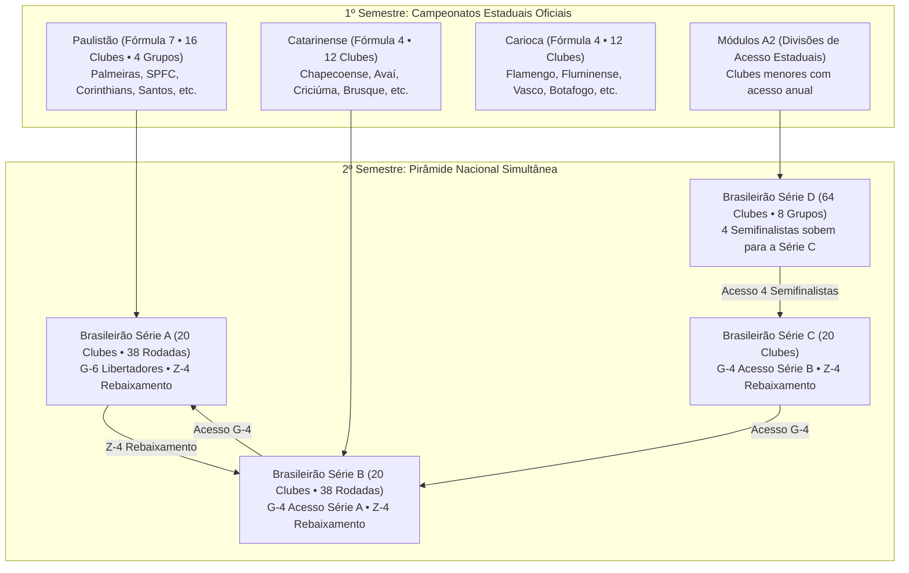
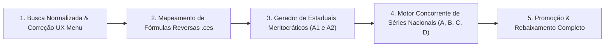

# SPEC-009: Simulação Completa da Pirâmide Nacional e Estaduais Multi-Divisão (Engenharia Reversa de Regras & Busca Acentuação/Case Insensitive)

| Metadado | Detalhes |
| :--- | :--- |
| **Status** | Proposto / Em Especificação Técnica Completa |
| **Data** | 13/10/2026 |
| **Autor** | Antigravity AI & Alex Chagas |
| **Módulo** | Seleção de Clubes (UX/UI & Busca Normalizada), Motor de Simulação Multi-Divisão, Calendário Unificado com Engenharia Reversa dos Arquivos `.ces` |
| **Alinhamento** | Fidelidade Histórica (Brasfoot Original via Engenharia Reversa), Profundidade de Universo Completo, UX Sem Fricção |

---

## 1. Visão do Produto & Objetivos de Negócio (PRD)

### 1.1. Contexto do Problema
O Champs Manager possui em seu banco de dados mais de 3.200 clubes distribuídos pelo Brasil e pelo mundo. No entanto, o usuário e seus jogadores relatam três problemas críticos de experiência e fidelidade:

1. **Dificuldade e Frustração na Busca de Clubes (Caso do Avaí / Havaí):**
   * Usuários não conseguem encontrar seus times porque a busca atual é estrita: digitações com ou sem acento, variações fonéticas ou estados combinados com abas de divisão ocultam o clube.
   * O filtro de divisão ("Série A") permanece ativo silenciosamente quando o usuário escolhe um Estado ("SC"), exibindo apenas a Chapecoense e ocultando o Avaí (Série B).
2. **Estaduais Arbitrários Sem Critério de Elite:**
   * Quando o jogador escolhe a Portuguesa (Série D), o Campeonato Paulista gerado inclui 12 times aleatórios da base de dados e **exclui Palmeiras, São Paulo, Corinthians e Santos**.
   * Em Santa Catarina, times de menor tradição ocupavam vagas que deveriam ser da elite estadual.
3. **Ausência das Regras Oficiais Específicas de Cada Campeonato (Engenharia Reversa):**
   * Cada federação estadual possui sua própria fórmula e regulamento oficial (ex: o Paulistão com 16 times divididos em 4 grupos jogando contra os demais grupos; Catarinense/Gaúcho/Mineiro/Carioca com 12 times e 4 semifinalistas; Baiano/Pernambucano com 10 times; estados menores com 8 times).
   * O jogo tratava todos os estaduais genericamente com 12 times em turno único, desrespeitando o regulamento fiel dos arquivos originais (`conf_estadual/*.ces`).

### 1.2. Objetivos Principais (OKRs)
* **Objetivo 1: Busca Omnibox Normalizada (Zero Fricção):** Busca tolerante a acentos, cedilhas, maiúsculas/minúsculas e caracteres especiais (ex: `avai` encontra `Avaí`; `sao paulo` encontra `São Paulo`; `gremio` encontra `Grêmio`).
* **Objetivo 2: Engenharia Reversa das Fórmulas Estaduais (`.ces`):** Integrar a matriz exata de fórmulas de cada federação estadual mapeada diretamente do motor original (`best/aq.java` e `conf_estadual/*.ces`).
* **Objetivo 3: Pirâmide Nacional Simultânea Completa:** Simulação concorrente e viva das Séries A, B, C e D no 2º semestre, com tabelas e classificações atualizadas rodada a rodada.
* **Objetivo 4: Módulos de Elite (A1) e Acesso (A2) nos Estaduais:** Elite preenchida por mérito esportivo (clubes de Série A $\rightarrow$ B $\rightarrow$ C $\rightarrow$ D $\rightarrow$ nível/reputação) e clubes restantes disputando o Módulo de Acesso (A2).

---

## 2. Engenharia Reversa: Regulamentos e Fórmulas Oficiais dos Estaduais

A análise reversa realizada no pacote `best/aq.java`, `best/w.java` e na decodificação binária dos 25 arquivos de configuração `conf_estadual/*.ces` revela a matriz exata de fórmulas utilizadas:

### 2.1. Matriz de Fórmulas do Motor (`aq.sL`)
O motor original define 11 fórmulas parametrizadas de campeonatos estaduais:

| Fórmula ID | Nome / Estrutura Original | Qtd Times (`nTimes`) | Grupos (`nGrupos`) | Mata-mata (`mataMata`) | Turnos (`doisTurnos`) | Rebaixados Padrão | Estados que Utilizam (Divisão 1) |
| :---: | :--- | :---: | :---: | :---: | :---: | :---: | :--- |
| **`7`** | **16 times • 4 grupos (Fórmula SP)** | **16** | **4** (A, B, C, D) | **8** (Quartas, Semi, Final) | 0 (joga contra outros grupos) | **2** | **São Paulo (SP)** |
| **`4`** | **12 times • 4 classificados** | **12** | 0 (Único) | **4** (Semi e Final) | 0 (Turno único) | **2** | **SC, RJ, MG, RS, PR, GO** |
| **`2`** | **10 times • 4 classificados** | **10** | 0 (Único) | **4** (Semi e Final) | 0 (Turno único) | **2** | **BA, CE, PE, MT** |
| **`1`** | **8 times • 4 classificados** | **8** | 0 (Único) | **4** (Semi e Final) | 0 (Turno único) | **2** | **AC, AL, AM, AP, DF, ES, MA, MS, PA, RN, RO, RR, TO** |
| **`0`** | **6 times • padrão** | **6** | 0 (Único) | **2** (Final direta) | 1 (Turno e Returno) | **2** | **PB** |

### 2.2. Detalhamento das Regras Específicas por Região

#### A. Campeonato Paulista (Fórmula `7` • 16 Clubes)
* **Formato Real:** 16 clubes divididos em 4 chaves de 4 times (Grupos A, B, C e D).
* **Fase Inicial (12 Rodadas):** Os times de um grupo jogam exclusivamente contra os 12 times dos outros 3 grupos (nunca se enfrentam na fase inicial dentro do mesmo grupo).
* **Classificação:** Os 2 primeiros colocados de cada grupo avançam para o mata-mata (Quartas de Final).
* **Quartas de Final:** Jogo único entre o 1º e o 2º do mesmo grupo ($1^\circ A \times 2^\circ A$, $1^\circ B \times 2^\circ B$, etc.).
* **Semifinais e Finais:** Jogos eliminatórios (Ida e Volta na grande final).
* **Rebaixamento:** Os 2 clubes de pior campanha geral caem para a Série A2.

#### B. Campeonatos Catarinense, Gaúcho, Mineiro, Carioca e Paranaense (Fórmula `4` • 12 Clubes)
* **Participantes:** 12 clubes na elite (Módulo A1).
* **Fase de Classificação:** 11 rodadas em turno único de pontos corridos (todos contra todos).
* **Mata-mata:** 4 melhores colocados avançam para as Semifinais (1º x 4º, 2º x 3º) e os vencedores disputam a Final.
* **Rebaixamento:** Os 2 últimos colocados (11º e 12º) caem para a 2ª Divisão Estadual (Módulo A2).

#### C. Campeonatos Baiano, Pernambucano, Cearense e Mato-Grossense (Fórmula `2` • 10 Clubes)
* **Participantes:** 10 clubes na elite (9 rodadas de turno único).
* **Mata-mata:** 4 classificados para as semifinais e final.
* **Rebaixamento:** 2 rebaixados para a 2ª divisão.

#### D. Estados Menores (Fórmula `1` • 8 Clubes)
* **Participantes:** 8 clubes (7 rodadas de turno único).
* **Mata-mata:** Semifinal e Final com os 4 melhores.

---

## 3. Especificação da Busca Textual Normalizada (Case Insensitive & Sem Acentos)

Para resolver definitivamente o caso relatado (onde "Havaí" ou "Avai" não encontrava o clube por causa de acentuação, maiúsculas ou filtro de divisão pré-ativo):

### 3.1. Utilitário de Normalização Canônica (`stringNormalizer.ts`)
Criar uma função padronizada que remove diacríticos (acentos, tils, cedilhas, tremas) e caracteres não alfanuméricos:

```typescript
/**
 * Normaliza uma string para comparação fonética e busca tolerante:
 * - Converte para minúsculas
 * - Decompõe diacríticos NFD e remove marcas Unicode (acentos, til, cedilha)
 * - Remove pontuações e caracteres especiais
 */
export function normalizeSearchString(text: string): string {
  if (!text) return '';
  return text
    .normalize('NFD')
    .replace(/[\u0300-\u036f]/g, '') // remove acentos e cedilhas (ã -> a, ç -> c)
    .toLowerCase()
    .replace(/[^a-z0-9]/g, ' ')      // substitui pontuações por espaço
    .replace(/\s+/g, ' ')
    .trim();
}
```

### 3.2. Dicionário de Variações Fonéticas e Apelidos Populares
Para casos consagrados onde torcedores usam grafias populares ou erros comuns:
```typescript
const ALIASES: Record<string, string[]> = {
  'avai': ['havai', 'avahy', 'leao da ilha'],
  'athletico paranaense': ['atletico pr', 'furacao', 'cap'],
  'atletico mineiro': ['atletico mg', 'galo'],
  'botafogo sp': ['botafogo ribeirao', 'pantera'],
  'corinthians': ['timao', 'coringao'],
  'flamengo': ['mengo', 'rubro negro'],
  'palmeiras': ['verdao', 'palestra'],
  'sao paulo': ['tricolor', 'spfc'],
};
```

### 3.3. Comportamento do Filtro na Interface (`MainMenu.tsx`)
1. **Busca Omnibox Prioritária:** Se o usuário digitar $\ge 2$ caracteres na busca:
   * **Ignora o filtro de divisão ativo:** Se estava em "Série A" e buscou "Avaí", exibe o Avaí imediatamente (mesmo ele sendo Série B).
   * **Ignora o filtro de estado se não houver match no estado atual:** Se estava com "SP" filtrado e buscou "Chapecoense", remove automaticamente a restrição de SP para exibir a Chapecoense.
2. **Seleção de Estado Limpa a Divisão:** Ao mudar o dropdown para um Estado específico (ex: "Santa Catarina"):
   * O seletor de divisão muda automaticamente para **"Todos do Estado"**.
   * A lista mostra todos os 28 clubes de SC, ordenados por divisão e relevância.

---

## 4. Arquitetura da Pirâmide Nacional e Estaduais Multi-Divisão



### 4.1. Alocação Meritocrática dos Clubes na Elite Estadual
A função de convocação dos estaduais segue a regra decompilada de `h/D.java`:
$$\text{Score} = (10 - \text{divisão nacional}) \times 1000 + (\text{level} \times 10) + \text{reputation}$$

1. Clubes de **Série A** têm prioridade máxima na elite de seus respectivos estados.
2. Clubes de **Série B**, seguidos de **Série C**, completam as vagas.
3. Se restarem vagas para atingir a quantidade da fórmula (`nTimes`), entram os clubes de **Série D / Acesso** com maior nível e reputação.
4. **Garantia Absoluta:**
   * **Paulistão:** Palmeiras, São Paulo, Corinthians e Santos entram **obrigatoriamente**.
   * **Catarinense:** Chapecoense, Avaí, Criciúma, Brusque e Figueirense entram **obrigatoriamente**.
   * **Carioca:** Flamengo, Fluminense, Vasco e Botafogo entram **obrigatoriamente**.
   * **Gaúcho:** Grêmio, Internacional, Juventude e Caxias entram **obrigatoriamente**.
   * **Mineiro:** Atlético-MG, Cruzeiro, América-MG entram **obrigatoriamente**.

### 4.2. Módulo de Acesso Estadual (Série A2)
* Caso o usuário selecione um time que não se classificou para a elite do estado (ex: Portuguesa Santista, XV de Jaú, Metropolitano-SC, etc.):
  * O jogador disputa o **Módulo A2 (Acesso Estadual)** daquele estado.
  * O **Módulo A1** do estado é simulado em paralelo com tabelas visíveis no jogo.
  * O campeão e o vice da A2 são promovidos para a A1 no ano seguinte, enquanto os 2 rebaixados da A1 descem para a A2.

### 4.3. Simulação Concorrente de Todas as Divisões Nacionais
* No 2º semestre, todas as 4 divisões nacionais (Séries A, B, C e D) são geradas e simuladas sincronizadamente a cada rodada.
* O componente `ClubOverview.tsx` passa a exibir tabs ou sub-abas de navegação nacional:
  * `[Série A]` `[Série B]` `[Série C]` `[Série D]`
* Todos os clubes têm artilharia, cartões e pontuação registrados no banco em memória.

---

## 5. Plano de Implementação em 5 Passos



### Passo 1: Busca Normalizada e Hotfix UX no Menu Inicial
* Criar `web/src/utils/stringNormalizer.ts` com remoção de acentos (`NFD`), conversão para minúsculas e aliases fonéticos ("havai" $\rightarrow$ "avai").
* Atualizar `MainMenu.tsx`:
  * Fazer a busca comparar strings normalizadas.
  * Ao digitar na busca, liberar a filtragem restritiva de divisão.
  * Ao selecionar um Estado no dropdown, mudar o filtro de divisão para `'all'`.

### Passo 2: Mapeamento de Fórmulas Oficiais dos Estaduais
* Criar `web/src/data/stateLeagueFormulas.ts` contendo as 25 configurações estaduais extraídas dos arquivos `.ces`:
  * SP $\rightarrow$ Fórmula 7 (16 times, 4 grupos de 4).
  * SC, RJ, MG, RS, PR, GO $\rightarrow$ Fórmula 4 (12 times, 4 classificados).
  * BA, CE, PE, MT $\rightarrow$ Fórmula 2 (10 times, 4 classificados).
  * Demais $\rightarrow$ Fórmula 1 (8 times) e Fórmula 0 (6 times).

### Passo 3: Geração de Calendário Estadual Fiel com Módulos A1 e A2
* Em `calendarGenerator.ts`, aplicar `sortClubsForStateChampionship` antes de alocar os clubes.
* Gerar os grupos do Paulistão (4 grupos de 4 com jogos inter-chaves) e as tabelas oficiais dos demais estados.
* Alocar os clubes excedentes no Módulo A2 estadual.

### Passo 4: Simulação Concorrente das Divisões Nacionais
* Em `initialData.ts` e `crossSeasonSimulation.ts`, inicializar e rodar em lote as Séries A, B, C e D completas do Brasil (ou do país principal selecionado).
* Adicionar suporte no `ClubOverview.tsx` para alternar entre as tabelas das divisões daquele país.

### Passo 5: Transição de Temporada e Promoção/Rebaixamento Completo
* Em `qualification.ts`, executar as 4 promoções e 4 rebaixamentos entre as Séries A $\leftrightarrow$ B $\leftrightarrow$ C $\leftrightarrow$ D.
* Executar as promoções e rebaixamentos estaduais entre os Módulos A1 $\leftrightarrow$ A2.

---

## 6. Critérios de Aceitação e Testes de Homologação

1. **Busca Tolerante e Sem Frustração:**
   * [ ] Digitar "avai", "havai", "Avaí" ou "AVAI" no menu inicial exibe o Avaí com escudo e dados instantaneamente.
   * [ ] Digitar "sao paulo", "Sao Paulo" ou "SÃO PAULO" encontra o São Paulo FC imediatamente.
   * [ ] Ao selecionar o estado "Santa Catarina" no dropdown, a tela exibe imediatamente os 28 clubes de SC, incluindo Avaí (Série B), Chapecoense (Série A), Criciúma (Série B) e Figueirense (Série C).
2. **Fidelidade do Campeonato Paulista (Paulistão):**
   * [ ] Ao iniciar um save com a Portuguesa, o Paulistão conta com 16 clubes divididos em 4 grupos.
   * [ ] Palmeiras, São Paulo, Corinthians e Santos estão obrigatoriamente presentes na elite do Paulistão.
3. **Fidelidade do Campeonato Catarinense:**
   * [ ] Ao iniciar um save com a Chapecoense ou Avaí, a 1ª Divisão conta com 12 times incluindo Avaí, Chapecoense, Criciúma, Brusque, Figueirense, Joinville e Marcílio Dias.
4. **Navegação pelas Divisões Nacionais:**
   * [ ] Ao jogar com a Portuguesa na Série D, o jogador pode navegar até a tabela da Série A, Série B e Série C e ver os resultados reais de cada rodada sendo simulados.
