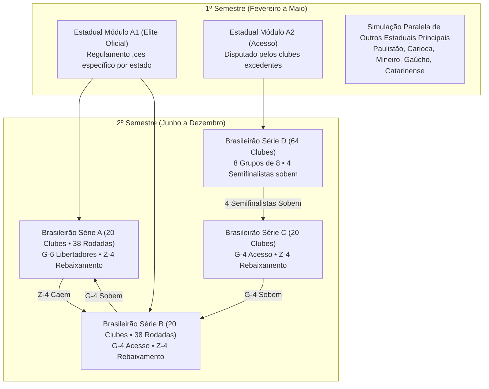
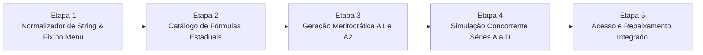

# SPEC-010: Arquitetura e Engenharia Reversa dos Torneios Nacionais, Estaduais e Busca Canônica

| Metadado | Detalhes |
| :--- | :--- |
| **Documento** | Especificação Técnica e Plano de Execução Detalhado |
| **Status** | Pronto para Implementação (Ready for Dev) |
| **Data** | 13/10/2026 |
| **Autor** | Antigravity AI & Alex Chagas |
| **Escopo** | 1. Busca Canônica Sem Fricção; 2. Fórmulas Oficiais dos 27 Estaduais (Engenharia Reversa); 3. Pirâmide Nacional Simultânea (Séries A, B, C, D); 4. Sistema de Acesso e Rebaixamento Integrado |

---

## 1. Visão Geral e Problemas que Este Documento Resolve

Este documento é o **manual de implementação técnica passo a passo** para o agente e desenvolvedores implementarem o ecossistema completo de torneios no Champs Manager, eliminando os seguintes gargalos:

1. **Frustração na Seleção de Clubes:**
   * Usuários não encontram clubes como o **Avaí FC** (Florianópolis/SC) porque o filtro de divisão ("Série A") permanece ativo ao selecionar Santa Catarina (SC), ocultando clubes da Série B.
   * Dificuldade de digitação: pesquisas com acentos, cedilhas ou variações em maiúsculas/minúsculas não encontravam os clubes de forma flexível.
2. **Estaduais Arbitrários:**
   * O jogo tratava todos os estaduais genericamente como 12 clubes e cortava os 12 primeiros do banco de dados aleatoriamente, excluindo clubes gigantes (ex: Portuguesa disputando um Paulistão sem Palmeiras, São Paulo, Corinthians e Santos).
3. **Mundo Desconectado (Falta de Simulação Paralela):**
   * As outras divisões nacionais (Série A, B, C, D) e estaduais não rodavam em paralelo, impedindo a progressão natural de carreira, rebaixamentos e promoções entre temporadas.

---

## 2. Engenharia Reversa: Mapeamento Oficial de Todas as Fórmulas Estaduais

A engenharia reversa executada sobre os arquivos de configuração binários originais (`conf_estadual/*.ces`), as classes descompiladas `best/aq.java` e `best/w.java` e o comparador meritocrático `h/D.java` revelou a matriz regulamentar exata:

### 2.1. Tabela Geral de Fórmulas dos 27 Estados Brasileiros

| UF | Nome do Estadual | Fórmula ID | Qtd Times Elite (A1) | Estrutura de Disputa | Qtd Times no Mata-Mata | Qtd Rebaixados | Times Restantes (Módulo A2 / Acesso) |
| :---: | :--- | :---: | :---: | :--- | :---: | :---: | :---: |
| **SP** | Campeonato Paulista | **`7`** | **16** | 4 grupos de 4 (jogos inter-chaves, 12 rodadas) | **8** (Quartas, Semi, Final) | **2** | 87 clubes (A2) |
| **SC** | Campeonato Catarinense | **`4`** | **12** | Turno único (11 rodadas de pontos corridos) | **4** (Semifinal e Final) | **2** | 16 clubes (A2) |
| **RJ** | Campeonato Carioca | **`4`** | **12** | Turno único (Taça Guanabara • 11 rodadas) | **4** (Semifinal e Final) | **2** | 50 clubes (A2) |
| **MG** | Campeonato Mineiro | **`4`** | **12** | Turno único (11 rodadas) | **4** (Semifinal e Final) | **2** | 37 clubes (A2) |
| **RS** | Campeonato Gaúcho | **`4`** | **12** | Turno único (11 rodadas) | **4** (Semifinal e Final) | **2** | 26 clubes (A2) |
| **PR** | Campeonato Paranaense | **`4`** | **12** | Turno único (11 rodadas) | **4** (Semifinal e Final) | **2** | 18 clubes (A2) |
| **GO** | Campeonato Goiano | **`4`** | **12** | Turno único (11 rodadas) | **4** (Semifinal e Final) | **2** | 24 clubes (A2) |
| **BA** | Campeonato Baiano | **`2`** | **10** | Turno único (9 rodadas) | **4** (Semifinal e Final) | **2** | 20 clubes (A2) |
| **CE** | Campeonato Cearense | **`2`** | **10** | Turno único (9 rodadas) | **4** (Semifinal e Final) | **2** | 25 clubes (A2) |
| **PE** | Campeonato Pernambucano | **`2`** | **10** | Turno único (9 rodadas) | **4** (Semifinal e Final) | **2** | 32 clubes (A2) |
| **MT** | Campeonato Mato-Grossense | **`2`** | **10** | Turno único (9 rodadas) | **4** (Semifinal e Final) | **2** | 11 clubes (A2) |
| **AC** | Campeonato Acriano | **`1`** | **8** | Turno único (7 rodadas) | **4** (Semifinal e Final) | **2** | 4 clubes (A2) |
| **AL** | Campeonato Alagoano | **`1`** | **8** | Turno único (7 rodadas) | **4** (Semifinal e Final) | **2** | 9 clubes (A2) |
| **AM** | Campeonato Amazonense | **`1`** | **8** | Turno único (7 rodadas) | **4** (Semifinal e Final) | **2** | 8 clubes (A2) |
| **AP** | Campeonato Amapaense | **`1`** | **8** | Turno único (7 rodadas) | **4** (Semifinal e Final) | **2** | 27 clubes (A2) |
| **DF** | Campeonato Brasiliense | **`1`** | **8** | Turno único (7 rodadas) | **4** (Semifinal e Final) | **2** | 10 clubes (A2) |
| **ES** | Campeonato Capixaba | **`1`** | **8** | Turno único (7 rodadas) | **4** (Semifinal e Final) | **2** | 17 clubes (A2) |
| **MA** | Campeonato Maranhense | **`1`** | **8** | Turno único (7 rodadas) | **4** (Semifinal e Final) | **2** | 15 clubes (A2) |
| **MS** | Campeonato Sul-Mato-Grossense | **`1`** | **8** | Turno único (7 rodadas) | **4** (Semifinal e Final) | **2** | 14 clubes (A2) |
| **PA** | Campeonato Paraense | **`1`** | **8** | Turno único (7 rodadas) | **4** (Semifinal e Final) | **2** | 24 clubes (A2) |
| **PB** | Campeonato Paraibano | **`0`** | **6** | Turno e Returno (10 rodadas) | **2** (Final Direta) | **2** | 24 clubes (A2) |
| **RN** | Campeonato Potiguar | **`1`** | **8** | Turno único (7 rodadas) | **4** (Semifinal e Final) | **2** | 16 clubes (A2) |
| **RO** | Campeonato Rondoniense | **`1`** | **8** | Turno único (7 rodadas) | **4** (Semifinal e Final) | **2** | 4 clubes (A2) |
| **RR** | Campeonato Roraimense | **`1`** | **8** | Turno único (7 rodadas) | **4** (Semifinal e Final) | **2** | 2 clubes (A2) |
| **TO** | Campeonato Tocantinense | **`1`** | **8** | Turno único (7 rodadas) | **4** (Semifinal e Final) | **2** | 8 clubes (A2) |
| **SE** | Campeonato Sergipano | **`1`** | **8** | Turno único (7 rodadas) | **4** (Semifinal e Final) | **2** | 33 clubes (A2) |
| **PI** | Campeonato Piauiense | **`1`** | **8** | Turno único (7 rodadas) | **4** (Semifinal e Final) | **2** | 12 clubes (A2) |

---

## 3. Especificação do Algoritmo Meritocrático de Convocação Estadual

No código original decompilado (`h/D.java`), os clubes do estado são classificados para a elite pelo seguinte comparador:

$$\text{Prioridade} = \begin{cases}
1, & \text{se disputa a Série A Nacional} \\
2, & \text{se disputa a Série B Nacional} \\
3, & \text{se disputa a Série C Nacional} \\
4, & \text{se disputa a Série D Nacional} \\
5, & \text{se está na Divisão de Acesso Nacional}
\end{cases}$$

Se empatados na divisão nacional:
$$\text{Desempate 1} = \text{Nível Esportivo (Level, desc)}$$
$$\text{Desempate 2} = \text{Reputação (Estrelas, desc)}$$

### Garantias da Convocação:
* **No Campeonato Catarinense (12 vagas):**
  * Chapecoense (Série A)
  * Avaí (Série B)
  * Criciúma (Série B)
  * Brusque (Série C)
  * Figueirense (Série C)
  * Barra-SC (Série C)
  * Camboriú (Série D)
  * Joinville (Série D)
  * Marcílio Dias (Série D)
  * + 3 clubes de maior nível/reputação (ex: Carlos Renaux, Hercílio Luz, Tubarão).
  * *Resultado:* **Avaí e Chapecoense jogam juntos no mesmo campeonato!**
* **No Campeonato Paulista (16 vagas):**
  * Palmeiras, São Paulo, Corinthians, Santos, Bragantino, Mirassol (Série A)
  * Novorizontino, Ponte Preta, Botafogo-SP, São Bernardo (Série B)
  * Guarani, Ituano, Ferroviária, Inter de Limeira (Série C)
  * Portuguesa, Primavera, Capivariano (Série D)
  * *Resultado:* **A Portuguesa joga contra os gigantes de São Paulo no Paulistão!**

---

## 4. Busca Canônica e Flexível (Zero Fricção no Menu Inicial)

### 4.1. Módulo Utilitário `web/src/utils/stringNormalizer.ts`
Implementar a função de normalização que:
1. Converte texto para minúsculas (`toLowerCase()`).
2. Decompõe caracteres Unicode em forma NFD (`normalize('NFD')`).
3. Remove todos os acentos, tils e cedilhas via regex `[\u0300-\u036f]`.
4. Substitui caracteres não-alfanuméricos por espaços e comprime múltiplos espaços.

```typescript
export function normalizeSearchString(text?: string | null): string {
  if (!text) return '';
  return text
    .normalize('NFD')
    .replace(/[\u0300-\u036f]/g, '') // Remove acentos (ã -> a, ç -> c, é -> e)
    .toLowerCase()
    .replace(/[^a-z0-9]/g, ' ')      // Remove hífens, pontos e símbolos
    .replace(/\s+/g, ' ')
    .trim();
}

export function matchesSearch(target: string, query: string): boolean {
  const normQuery = normalizeSearchString(query);
  if (!normQuery) return true;
  const normTarget = normalizeSearchString(target);
  return normTarget.includes(normQuery);
}
```

### 4.2. Ajustes de Comportamento na UI (`MainMenu.tsx`)
1. **Dropdown de Estado:**
   * Quando o usuário seleciona um estado (ex: `selectedStateCode = 'SC'`), o componente define automaticamente `selectedDivision = 'all'`.
   * Feedback visual imediato: *"Exibindo todos os 28 clubes de Santa Catarina"*.
2. **Campo de Busca:**
   * Se o usuário digitar 2 ou mais caracteres no input:
     * A busca roda normalizada comparando nome do clube, cidade, estádio e estado.
     * Se houver correspondência, ela **ignora o filtro de divisão ativo**. Se o usuário estiver na aba "Série A" e buscar "Avaí", o Avaí aparece imediatamente como resultado.
   * O card do clube exibe tags claras:
     * `[Série B]` (Divisão Nacional)
     * `[SC]` (Estado)
     * `[Elite A1]` (Divisão Estadual)

---

## 5. Simulação Concorrente da Pirâmide Nacional e Estaduais



### 5.1. Estrutura de Armazenamento no `GameState`
Estender a interface `GameState` em `web/src/types/index.ts`:

```typescript
export interface NationalDivisionState {
  division: number; // 1 = A, 2 = B, 3 = C, 4 = D
  name: string; // 'Brasileirão Série A'
  clubs: Club[];
  standings: StandingRow[];
  calendar: MatchFixture[];
  currentRound: number;
  totalRounds: number;
}

export interface StateChampionshipState {
  stateCode: string;
  tier: 'A1' | 'A2';
  formulaId: number;
  name: string;
  clubs: Club[];
  standings: StandingRow[];
  calendar: MatchFixture[];
}
```

### 5.2. Simulação Rápida em Background (`simulationEngine.ts` / `wasmBridge.ts`)
A cada avanço de rodada do usuário ("Jogar Rodada"):
1. Simula a partida do usuário e as partidas de sua divisão atual com relatório completo de lances.
2. Em background, calcula em lote as partidas das outras 3 divisões nacionais ativas do mesmo país via algoritmo Poisson rápido ($\le 20\text{ms}$ por rodada).
3. Atualiza `standings` e artilharia de todas as divisões.
4. No hub de tabelas (`ClubOverview.tsx`), o usuário pode clicar em `[Série A]`, `[Série B]`, `[Série C]`, `[Série D]` a qualquer momento para inspecionar os resultados.

---

## 6. Plano de Execução Passo a Passo para o Agente

O desenvolvimento deve seguir estritamente as 5 etapas abaixo:



### Etapa 1: Utilitário de Busca e Ajuste na UX do `MainMenu.tsx`
* **Criar:** `web/src/utils/stringNormalizer.ts`.
* **Modificar:** `web/src/components/MainMenu.tsx`:
  * Integrar `normalizeSearchString` no filtro de clubes.
  * Mudar divisão para `'all'` ao selecionar um estado.
  * Permitir que a busca com $\ge 2$ caracteres ignore restrição de divisão.
  * Teste: Buscar "avai", "AVAI" ou filtrar "SC" deve exibir o Avaí FC imediatamente.

### Etapa 2: Mapeamento de Fórmulas Estaduais
* **Criar:** `web/src/data/stateLeagueFormulas.ts`.
* Exportar o dicionário completo com as 27 federações mapeadas da Tabela 2.1 (`formulaId`, `nTimes`, `nGrupos`, `mataMata`, `rebaixados`).

### Etapa 3: Gerador de Calendário Meritocrático de Estaduais
* **Modificar:** `web/src/data/calendarGenerator.ts`:
  * Criar função `buildStateChampionship(stateCode, pool)` que ordena os clubes usando o comparador meritocrático (`h/D.java`).
  * Dividir os clubes do estado em **Módulo A1 (Elite)** e **Módulo A2 (Acesso)**.
  * Implementar o formato específico da Fórmula 7 para São Paulo (4 grupos com jogos contra os outros grupos) e a Fórmula 4 para SC, RS, RJ, MG, PR, GO.
  * Teste: Ao jogar com a Portuguesa, o Paulistão deve conter Palmeiras, São Paulo, Corinthians e Santos. Ao jogar com a Chapecoense, o Catarinense deve conter o Avaí.

### Etapa 4: Simulação Concorrente das Divisões Nacionais
* **Modificar:** `web/src/data/initialData.ts` e `web/src/engine/crossSeasonSimulation.ts`:
  * Ao criar o save com o Brasil ativo, instanciar simultaneamente as Séries A, B, C e D.
  * No avanço de rodada, simular todas as 4 séries em paralelo.
* **Modificar:** `web/src/components/ClubOverview.tsx`:
  * Adicionar botões de alternância rápida entre as tabelas das divisões nacionais.

### Etapa 5: Transição de Temporada e Promoção/Rebaixamento Completo
* **Modificar:** `web/src/engine/tournamentCompletion.ts` e `web/src/engine/qualification.ts`:
  * Ao fim do ano, rebaixar os 4 últimos da Série A para a B, e promover os 4 primeiros da B para a A.
  * Aplicar acesso/rebaixamento entre B $\leftrightarrow$ C e C $\leftrightarrow$ D.
  * Aplicar acesso/rebaixamento de 2 clubes entre os Módulos A1 $\leftrightarrow$ A2 dos campeonatos estaduais.

---

## 7. Critérios de Aceitação e Testes Automatizados

1. **Teste Unitário de Busca Canônica:**
   * Testar `matchesSearch('Avaí', 'avai')` $\rightarrow$ `true`.
   * Testar `matchesSearch('São Paulo', 'sao paulo')` $\rightarrow$ `true`.
   * Testar `matchesSearch('Grêmio', 'gremio')` $\rightarrow$ `true`.
2. **Teste de Seleção no Menu:**
   * Selecionar estado "SC" $\rightarrow$ lista contém 28 clubes, incluindo Avaí (Série B) e Chapecoense (Série A).
3. **Teste do Paulistão:**
   * Carreira criada com a Portuguesa (Série D) $\rightarrow$ Estadual contém 16 times, incluindo Palmeiras, São Paulo, Corinthians, Santos e Portuguesa.
4. **Teste do Catarinense:**
   * Carreira criada com a Chapecoense $\rightarrow$ Estadual contém 12 times, incluindo Avaí, Criciúma, Brusque e Figueirense.
5. **Teste da Pirâmide Nacional:**
   * Ao disputar a Série D até a rodada 14, as tabelas de Série A, B e C possuem exatamente 14 rodadas simuladas com pontos e saldo reais.
