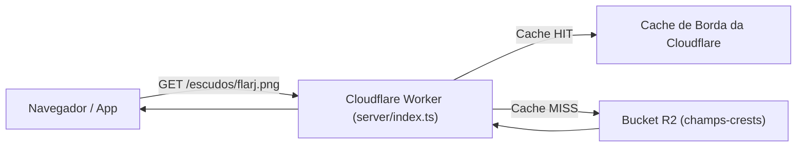

# Guia Definitivo: Configuração do Cloudflare R2 e Integração no Champs Manager

Este guia explica passo a passo como criar o bucket no **Cloudflare R2**, fazer o upload de todos os escudos e mini escudos, conectar ao nosso Cloudflare Worker e aplicar no sistema sem precisar mudar uma única linha de código nos componentes de interface!

---

## 1. Visão Geral da Arquitetura com R2

Hoje, o Cloudflare Workers Assets tenta empacotar os 17.000+ arquivos `.png` junto com o código da aplicação, quase estourando o limite de 20.000 arquivos no deploy.

Com o Cloudflare R2:
- **O código da aplicação** (`server/`, `web/`) continua sendo deployado normalmente via Git/Wrangler (com menos de 20 arquivos no total).
- **Os 17.000+ escudos** ficam armazenados com segurança no **Bucket R2** da Cloudflare (com capacidade ilimitada e **zero taxa de tráfego/egress**).
- **O Cloudflare Worker** (`server/index.ts`) intercepta as requisições `/escudos/*` e `/escudosMini/*` e serve direto do R2 com cache global de borda de 1 ano (`Cache-Control: public, max-age=31536000, immutable`).
- **O Frontend** continua usando as mesmas URLs exatas (`/escudos/flarj.png`). **Nenhum componente do jogo quebra**.



---

## 2. Passo 1: Criar o Bucket R2 na Cloudflare

Você pode criar o bucket de duas formas (pela web ou pelo terminal).

### Opção A: Pelo Terminal (Mais rápido via Wrangler)
Na raiz do projeto `champs-manager`, execute:

```bash
npx wrangler r2 bucket create champs-crests
```

### Opção B: Pelo Dashboard da Cloudflare
1. Acesse o [Dashboard da Cloudflare](https://dash.cloudflare.com/).
2. No menu lateral esquerdo, clique em **R2** (em *Storage & Databases*).
3. Se for seu primeiro acesso ao R2, clique para habilitar o plano gratuito (o plano Free inclui **10 GB de armazenamento** e 1 milhão de operações por mês grátis — nossos escudos usam menos de 50 MB!).
4. Clique no botão azul **Create bucket**.
5. Em **Bucket name**, digite: `champs-crests`.
6. Em **Location**, selecione *Automatic* ou *South America (São Paulo)* / *North America*.
7. Clique em **Create bucket**.

---

## 3. Passo 2: Conectar o Bucket no `wrangler.jsonc`

Para que o nosso servidor Worker tenha permissão nativa de ler os arquivos do R2 em milissegundos sem precisar de chaves de API secretas, adicionamos o *binding* no arquivo de configuração do Worker.

Abra [wrangler.jsonc](file:///Users/alexchagas/dev/champs-manager/wrangler.jsonc) e adicione a seção `"r2_buckets"`:

```jsonc
{
  "$schema": "node_modules/wrangler/config-schema.json",
  "name": "champs-manager",
  "main": "server/index.ts",
  "compatibility_date": "2026-03-01",
  "assets": {
    "directory": "./web/dist",
    "binding": "ASSETS",
    "html_handling": "auto-trailing-slash",
    "not_found_handling": "single-page-application"
  },
  "r2_buckets": [
    {
      "binding": "CRESTS_BUCKET",
      "bucket_name": "champs-crests"
    }
  ]
}
```

---

## 4. Passo 3: Configurar o Worker para Entregar os Escudos

No arquivo [server/index.ts](file:///Users/alexchagas/dev/champs-manager/server/index.ts), adicionamos a tipagem do binding `CRESTS_BUCKET` e a rota inteligente para servir os escudos:

```typescript
interface Env {
  ASSETS: Fetcher;
  DISCORD_WEBHOOK_URL?: string;
  CRESTS_BUCKET?: R2Bucket; // <- Binding R2 adicionado
}

export default {
  async fetch(request: Request, env: Env): Promise<Response> {
    const url = new URL(request.url);

    // 1. Interceptar requisições de escudos e servir diretamente do R2 com cache
    if (url.pathname.startsWith('/escudos/') || url.pathname.startsWith('/escudosMini/')) {
      if (env.CRESTS_BUCKET) {
        const key = url.pathname.slice(1); // Ex: "escudos/flarj.png"
        const object = await env.CRESTS_BUCKET.get(key);

        if (object) {
          const headers = new Headers();
          object.writeHttpMetadata(headers);
          headers.set('etag', object.httpEtag);
          // Cache longo de 1 ano na borda e no navegador (escudos são estáticos)
          headers.set('Cache-Control', 'public, max-age=31536000, immutable');
          headers.set('Content-Type', 'image/png');

          return new Response(object.body, { headers });
        }
      }
    }

    // 2. Se não for escudo ou não encontrar no R2, continua para a aplicação / ASSETS
    ...
  }
};
```

---

## 5. Passo 4: Fazer o Upload dos Escudos para o R2

Como são mais de 17.000 arquivos pequenos, fazer upload um por um na mão pelo site seria demorado. Criamos um script pronto em Python que faz o upload em lotes paralelos ultra-rápidos usando a API do R2 ou o Wrangler.

### Gerando as credenciais de API do R2 (Apenas 1 vez):
1. No Cloudflare Dashboard, vá em **R2** > **Overview**.
2. No menu direito, clique em **Manage R2 API Tokens**.
3. Clique em **Create API token**.
4. Defina:
   - **Permissions**: *Object Read & Write*
   - **Bucket**: *champs-crests*
5. Clique em **Create API Token**.
6. Guarde os 3 valores exibidos:
   - **Access Key ID**
   - **Secret Access Key**
   - **Endpoint** (formato: `https://<ACCOUNT_ID>.r2.cloudflarestorage.com`)

### Executando o script de upload:
Basta definir as variáveis no terminal e rodar o script (já deixaremos o script preparado em `scripts/upload_crests_to_r2.py`):

```bash
export R2_ACCOUNT_ID="seu_account_id"
export R2_ACCESS_KEY_ID="sua_access_key"
export R2_SECRET_ACCESS_KEY="sua_secret_key"
export R2_BUCKET_NAME="champs-crests"

python3 scripts/upload_crests_to_r2.py
```

O script vai ler `web/public/escudos/` e `web/public/escudosMini/` e enviar tudo com barra de progresso, pulando arquivos já existentes.

---

## 6. Passo 5: Desindexar do Git e Deixar o Deploy Leve

Depois que os arquivos estiverem salvos no bucket R2, podemos finalmente tirá-los do controle do Git (lembrando: **eles continuam no seu computador**, só deixam de ser rastreados):

```bash
# 1. Adicionar no .gitignore
echo -e "\nweb/public/escudos/\nweb/public/escudosMini/" >> .gitignore

# 2. Desindexar sem apagar do disco
git rm -r --cached web/public/escudos
git rm -r --cached web/public/escudosMini

# 3. Commitar
git add .gitignore server/index.ts wrangler.jsonc
git commit -m "feat: migrate club crests to Cloudflare R2 bucket"
git push origin main
```

---

## 7. Como Fica o Desenvolvimento Local vs Produção?

- **Em Desenvolvimento Local (`npm run dev`)**:
  Como os arquivos continuam na sua pasta `web/public/`, o Vite entrega as imagens diretamente do seu disco local na velocidade da luz.
- **Em Produção na Cloudflare**:
  O Worker entrega direto do R2 via Edge CDN.
- **No Celular / PWA Offline**:
  O Service Worker (já configurado no `vite.config.ts`) salva automaticamente no `CacheStorage` do aparelho qualquer escudo que o jogador visualiza, garantindo que partidas offline continuem com os escudos normais.
